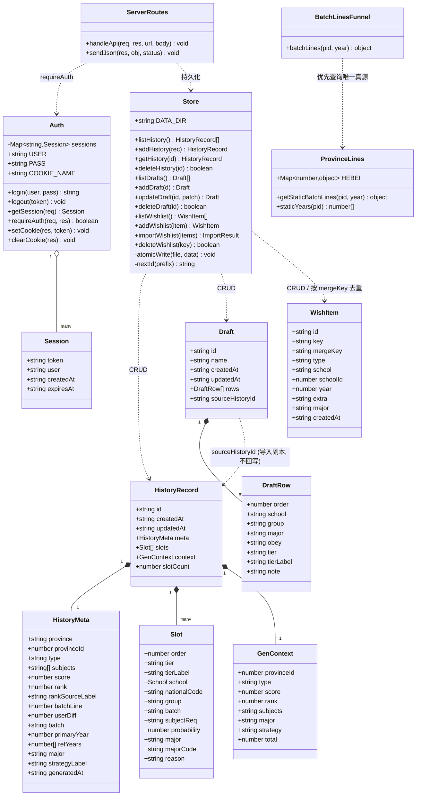
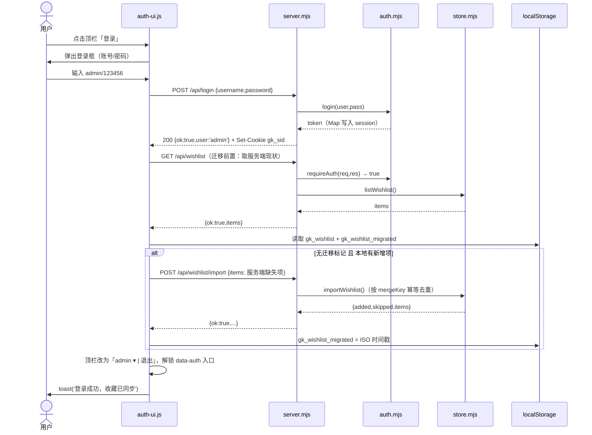
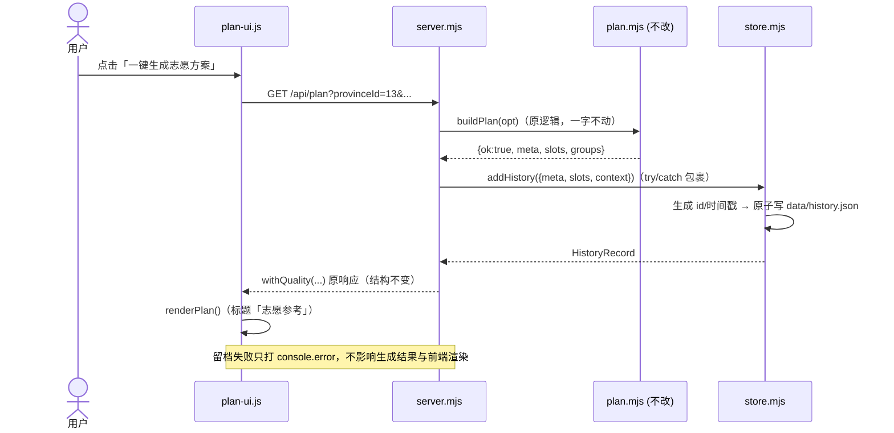
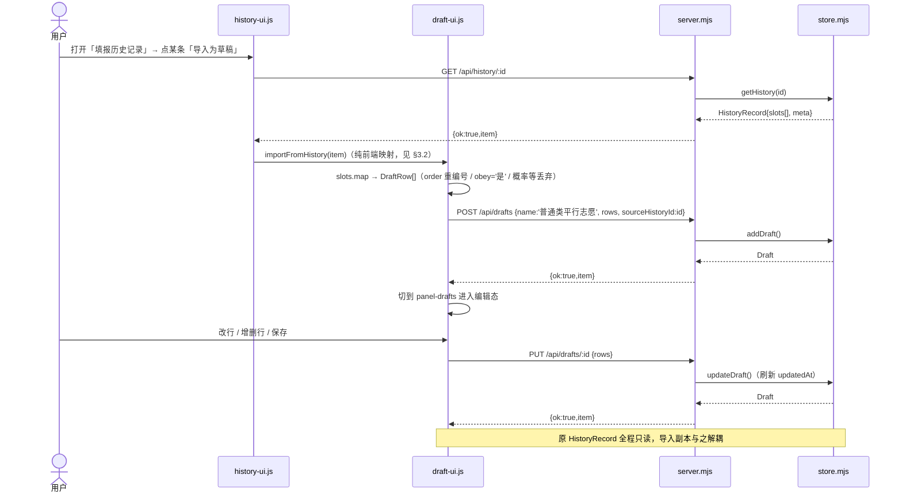
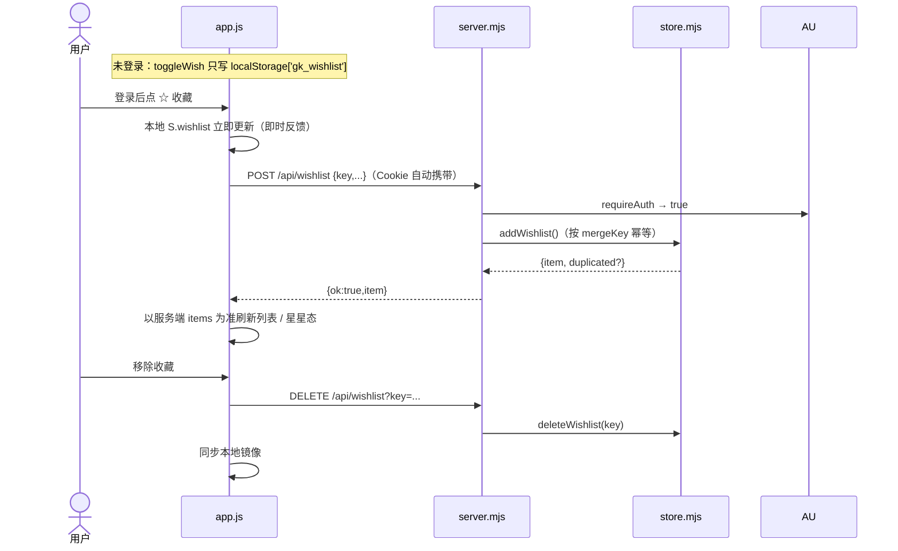
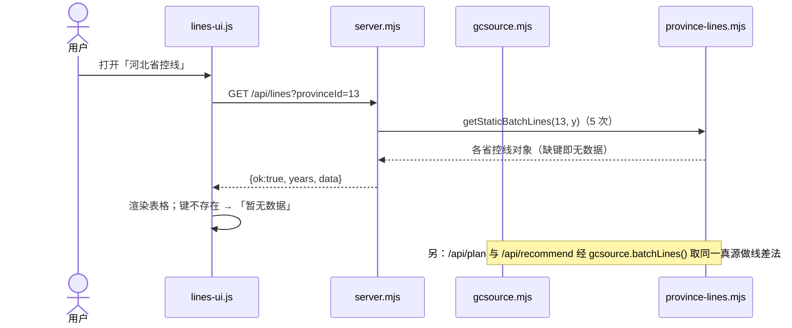
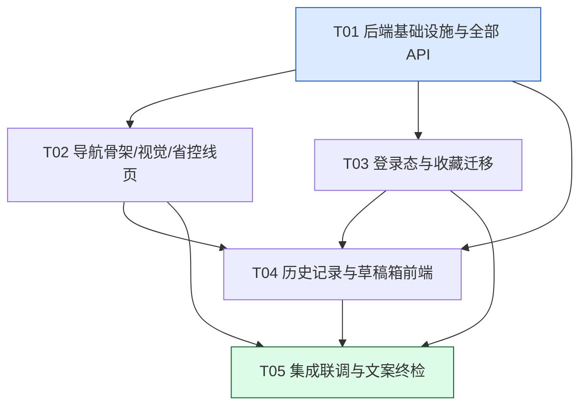

# 高考志愿助手 · 界面改版 v2 系统设计与任务分解

| 项 | 内容 |
| --- | --- |
| 文档语言 | 中文 |
| 项目代号 | `gaokao_zhiyuan_ui_v2` |
| 架构师 | 高见远（Bob） |
| 唯一需求依据 | `deliverables/software-company/ui-v2-prd.md` |
| 技术栈 | 原生 HTML/CSS/JS（无构建）+ Node.js `.mjs`（`node:sqlite`、零第三方依赖） |
| 适用形态 | 单用户、纯本地部署、数据不外传 |
| 文档状态 | 定稿，供工程师执行 |

---

## 一、实现方案总述与技术选型

### 1.1 核心结论（先看这里）

| 决策项 | 结论 | 理由 |
| --- | --- | --- |
| 框架 | **沿用原生 JS + `.mjs`，不引入任何框架/构建工具** | PRD 明确不重写已验证模块；8 个功能页的 DOM/事件已稳定，引入框架会迫使重写 |
| 导航重构 | **只换"入口 DOM"，不换"功能页 DOM"**：保留全部 `panel-*` id 与内部逻辑，把顶部 8 个平铺 `<button data-tab>` 平移到侧边栏，`app.js` 仍按 `panel- + data-tab` 切换 | 满足"只改入口与标题、不重写原功能页面"；回归面最小 |
| R7 省控线单一数据源 | **选 (a)：新增 `server/province-lines.mjs` 作为唯一真源**；在 **`gcsource.mjs::batchLines()`** 内优先查它（不改 `gcdb.mjs`、不改 `plan.mjs`/`recommend.mjs`） | 见 §3.1 详细论证；保证"页面展示"与"线差法算法输入"同源，且不破坏返回结构 |
| R3 草稿导入 | 输出明确 6 列字段映射表（§3.2），概率/位次等无对应字段**不进草稿行**，仍留在生成记录快照中 | 与原型草稿表（序号/院校专业组/专业/服从调剂/梯度/操作）一致 |
| R4 收藏迁移 | 合并键 = 现有 `item.key`（已含院校 ID + 专业组/专业标识）；登录成功后一次性上传，标记 `gk_wishlist_migrated` | 沿用现有业务键，零数据模型变更；服务端再做一次幂等去重 |
| R6 打印区删文案 | **删 DOM 容器 `#q-print-footer` 与全部文案节点，`styles.css` 打印规则整段保留** | 容器不存在 → `QualityUI.setSnapshot()` 的 `if (el)` 守卫自然空转，不会出现空白块，且无需改 `quality-ui.js` |
| 会话 | `auth.mjs` 内存 `Map` + HttpOnly Cookie `gk_sid`，服务重启即失效 | PRD 第四节明确允许内存方案 |
| 自动留档 | **在 `server.mjs` 的 `/api/plan` 路由内、拿到 `buildPlan()` 成功结果后同步落盘**，前端不改生成逻辑 | 一次请求内完成，记录不依赖前端是否还在页面；算法文件零改动 |
| 弱安全 | `admin/123456` 硬编码；`auth.mjs` 文件头与 `启动.bat` 注释必须写「仅限个人本地使用，勿公网部署」 | PRD R5 |

### 1.2 技术挑战与方法

| 挑战 | 处理方法 |
| --- | --- |
| `batchLines()` 河北 2022–2024 返空，但 `plan.mjs`/`recommend.mjs` 依赖其做线差法 | 静态模块补齐 7 个有值单元格，缺失键**不写入**，返回结构 `{"历史类|本科批":477,...}` 完全不变；hook 放在消费 funnel `gcsource.batchLines()` |
| 原 `app.js` 的 tab 切换硬绑定 `#tabs .tab` | 改为通用 `$$('[data-tab]')`，对旧顶栏和新侧边栏同时生效（解耦 T02/T03 并行） |
| 话术散落在 4 个文件、且与功能提示混排 | 按 PRD 第五节逐行白名单删除；「怎么操作」提示按行保留并同步改名 |
| 三个 JSON 文件并发写 | Node 单进程 + **同步读-改-原子写**（`writeFileSync(tmp)` → `renameSync`），不用异步 fs，避免事件循环交错 |
| 未登录收藏不能"看起来丢失" | 未登录全程走 localStorage；登录后首次合并上传并打标，之后读写直连服务端，localStorage 留作离线镜像 |

### 1.3 架构模式

分层但保持轻量：

```
web/  index.html(入口/DOM) ── app.js(全局状态/路由/收藏) ── funct 模块(plan-ui / auth-ui / history-ui / draft-ui / lines-ui / quality-ui)
                                     │ fetch(/api/*, credentials:same-origin)
server/ server.mjs(路由/鉴权门禁/静态服务)
        ├── auth.mjs      会话
        ├── store.mjs     JSON 持久化（history / drafts / wishlist）
        ├── province-lines.mjs  省控线唯一真源
        ├── gcsource.mjs  batchLines funnel（接入静态真源）
        └── 既有算法层（plan / recommend / gcdb / quality）★不改★
data/  history.json / drafts.json / wishlist.json（新增应用数据）+ 既有原始数据文件 ★不改★
```

---

## 二、文件清单（相对路径：`D:/AAAProject/AAAgithub/zhiyuan/`）

### 2.1 新增文件

| 文件 | 模块 | 职责 | 性质 |
| --- | --- | --- | --- |
| `高考志愿助手/server/auth.mjs` | 后端·会话 | `admin/123456` 校验、内存 token→session `Map`、`gk_sid` Cookie 读写、`requireAuth()`；文件头弱安全声明 | 新增 |
| `高考志愿助手/server/store.mjs` | 后端·存储 | 三份 JSON 的读写封装、id 生成、按 `key` 幂等去重、同步原子写 | 新增（**需要**） |
| `高考志愿助手/server/province-lines.mjs` | 后端·省控线 | 河北 2022–2026 静态表（唯一真源）+ `getStaticBatchLines(pid, year)`；缺失单元格不建键 | 新增（**R7 落点**） |
| `高考志愿助手/data/history.json` | 数据 | 生成记录数组，初始 `[]`，由 `store.mjs` 首次写入时创建 | 新增（应用数据） |
| `高考志愿助手/data/drafts.json` | 数据 | 草稿数组，初始 `[]` | 新增（应用数据） |
| `高考志愿助手/data/wishlist.json` | 数据 | 收藏数组，初始 `[]` | 新增（应用数据） |
| `高考志愿助手/web/auth-ui.js` | 前端·登录 | 顶栏登录/用户信息 DOM（自注入）、登录弹窗、会话探测、`AuthUI.isAuthenticated()/promptLogin()` | 新增 |
| `高考志愿助手/web/history-ui.js` | 前端·历史 | 生成记录列表、详情查看、「导入为草稿」按钮 | 新增 |
| `高考志愿助手/web/draft-ui.js` | 前端·草稿 | 草稿 CRUD、行编辑表格、从生成方案导入 + 字段映射 | 新增 |
| `高考志愿助手/web/lines-ui.js` | 前端·省控线 | 年份/科类切换、表格渲染、`暂无数据`降级、一分一档外链 URL 唯一常量与绑定 | 新增 |
| `deliverables/software-company/ui-v2-class-diagram.mermaid` | 设计产物 | 类图（本文 §5 摘出） | 新增（设计稿，非源码） |
| `deliverables/software-company/ui-v2-sequence-diagram.mermaid` | 设计产物 | 核心流程时序图（本文 §7 摘出） | 新增（设计稿，非源码） |

> 注：仓库根 `docs/` 下已有旧版 `class-diagram.mermaid` / `sequence-diagram.mermaid`（属于既有系统设计），本设计**不覆盖**它们，改用带 `ui-v2-` 前缀的新文件并存。

### 2.2 修改文件

| 文件 | 模块 | 改动性质 | 具体职责 |
| --- | --- | --- | --- |
| `高考志愿助手/server/server.mjs` | 后端·入口 | **改（唯一入口改造点）** | 导入 auth/store/province-lines；新增 login/logout/session、lines、wishlist CRUD、history CRUD、drafts CRUD 路由；`/api/plan` 成功后自动留档；启动日志删来源话术；不改任何算法分派 |
| `高考志愿助手/server/gcsource.mjs` | 后端·funnel | 小改（**R7 唯一 hook**） | `batchLines()` 首行查 `province-lines`，命中即返回；未命中维持原 DB→JSON 回退链 |
| `高考志愿助手/web/index.html` | 前端·入口 | **改（唯一 DOM 改造点，由 T02 独占）** | 顶栏渐变 + 侧边栏三组 + 系统组；新增 `panel-lines`/`panel-history`/`panel-drafts`；保留全部原 `panel-*`；删 PRD 第五节话术；4 个新脚本引用；外链 `<a>` 占位；「志愿方案」→「志愿参考」 |
| `高考志愿助手/web/styles.css` | 前端·样式 | 改（追加为主） | 新增 `.layout/.sidebar/.side-link/.card/.page-head/.tag-*` 等；**`@media print` 整段原样保留**（含 `.print-footer` 规则） |
| `高考志愿助手/web/app.js` | 前端·主控 | 改 | `api()` 支持 POST/PUT/DELETE + `credentials:'same-origin'`；tab 选择器改 `[data-tab]` + 登录门禁钩子；收藏读写切服务端 + 迁移标记；删第 62 行来源话术；`init()` 内触发 `AuthUI.init()` |
| `高考志愿助手/web/plan-ui.js` | 前端·方案 | 改（仅文案与按钮） | 标题「志愿方案」→「志愿参考」；删 CSV 免责行与来源 chip/链接/hint；AI 提示同步改名；预留「导入草稿」调用钩子（主按钮在 history-ui） |
| `高考志愿助手/启动.bat` | 运行 | 小改 | 追加注释「仅限个人本地使用，勿公网部署」 |
| `tools/api-test.mjs` | 测试 | 改 | 新增 auth/lines/wishlist/history/drafts 用例 |
| `tools/render-test.mjs` | 测试 | 改 | 新增导航/省控线/空态渲染用例 |

### 2.3 明确"不改"清单（强约束，diff 佐证）

`server/plan.mjs`、`server/recommend.mjs`、`server/gcdb.mjs`、`server/quality-core.mjs`、`server/quality.mjs`、`web/quality-ui.js`（理由见 §3.4）、`data/` 下全部既有原始数据文件。

---

## 三、四个风险点拍板

### 3.1 R7：省控线单一数据源 —— 选 (a) 服务端静态模块

**决策**：新增 `server/province-lines.mjs` 作为河北历年省控线的**唯一真源**；在 `gcsource.mjs::batchLines(pid, year)` 开头优先查询，**不改 `gcdb.mjs`**。

**为什么选 (a) 而不是前端静态表**

1. 前端内置表只解决"页面显示"，`batchLines()` 仍返空 → `plan.mjs:113` 与 `recommend.mjs:174` 的线差法继续失效，"展示分数"与"算法用的省控线"会不一致，违反单一真源。
2. 服务端模块可被 `/api/lines`（展示）与 `gcsource.batchLines`（算法）**共用同一份数据**，一处录入两处生效。
3. 静态表只写入 PRD 明确有值的 7 个单元格，缺键即"暂无数据"，天然禁止插值。

**为什么不 hook 在 `gcdb.mjs`**

- `gcdb.mjs` 是 SQLite 只读层，`quality.mjs` / `quality-core.mjs` 的数据质量审计依赖"库里真有什么"的口径；把静态值塞进它会被误认为库内数据，污染质量面板。
- `plan.mjs`、`recommend.mjs` 实际导入的是 `gcsource.mjs::batchLines`（见 `plan.mjs:21`、`recommend.mjs:17`），它才是下游消费 funnel。改这一处即覆盖全部算法调用。

**模块实现要点（可直接照抄）**

```js
// server/province-lines.mjs
// 河北（标准省码 13）历年省控线 —— 唯一真源，数据照 PRD 3.2 表格录入。
// 严禁插值：缺失单元格不写入对象，由展示层渲染为「暂无数据」。
const HEBEI = {
  2026: { '历史类|本科批': 485, '历史类|专科批': 200, '物理类|本科批': 443 },
  2025: { '历史类|本科批': 477, '历史类|专科批': 200, '物理类|本科批': 459 },
  2024: { '历史类|本科批': 449, '历史类|专科批': 200 },
  2023: { '历史类|本科批': 430, '历史类|专科批': 200 },
  2022: { '历史类|本科批': 443, '历史类|专科批': 200 },
};
export function getStaticBatchLines(pid, year) {
  if (Number(pid) !== 13) return {};
  return { ...(HEBEI[Number(year)] || {}) };
}
export const staticYears = (pid) => Number(pid) === 13
  ? Object.keys(HEBEI).map(Number).sort((a, b) => b - a) : [];
```

`gcsource.mjs` 改动（仅 2 行）：

```js
import { getStaticBatchLines } from './province-lines.mjs';
export function batchLines(pid, year) {
  const curated = getStaticBatchLines(pid, year);
  if (Object.keys(curated).length) return curated;   // ← 唯一真源优先
  // 以下原逻辑一字不动（DB → legacy JSON 回退）
  if (!HAVE_GC()) return legacyBatchLines(pid, year);
  return cached(`bl_${pid}_${year}`, () => { ... });
}
```

**兼容性保证**：返回仍是 `{ "科类|批次": number }`；`plan.mjs:113` 的 `batchLines[\`${typeName}|${batchFilter}\`]` 与 `recommend.mjs:174` 的 `batchLineOf()` 取值方式完全不变。物理类 2024/2023/2022 无键 → 线差法自动跳过、回退位次法，符合"无数据不得编造"。

### 3.2 R3：草稿导入字段映射表（基于实际代码，非臆测）

**上游真实字段**：`plan.mjs:348-365` 的 `slots[]`（`order / tier / tierLabel / school{name,id,...} / nationalCode / group / batch / subjectReq / probability / major / majorCode / majorProb / majorOptions / baseDiff / baseRank / latest / hist / years / stable / reason`）；历史记录保存的就是这份 `slots` 快照 + `meta`。
**下游真实列**：原型 `index.html:732` — 序号 / 院校专业组 / 专业 / 服从调剂 / 梯度 / 操作（PRD 3.5 增加"备注"）。

| # | 生成方案行字段（`slots[i]`） | 草稿行字段（`DraftRow`） | 映射规则 |
| --- | --- | --- | --- |
| 1 | `order` | `order` | **重新编号** 1..n（按当前顺序），不沿用旧序号 |
| 2 | `school.name` + `group` | `school` + `group` | `school` = `s.school.name` 原样；`group` = `s.group || ''`；展示时合并为「院校专业组」，空值显示「专业组招生（未细分）」 |
| 3 | `major` | `major` | 原样；空串表示"按专业组招生"，允许手工补填 |
| 4 | （无对应字段） | `obey` | **固定默认「是」**（PRD R3 指定），用户可改为「否」 |
| 5 | `tier` / `tierLabel` | `tier` / `tierLabel` | 原样映射：`chong→冲 / wen→稳 / bao→保`；若为空则留空由用户选择 |
| 6 | `reason[]`（可选拼接）+ `batch` | `note` | `note = (s.reason||[]).join(' ')`，可为空；`batch` 不单独建列，可拼入备注 |
| 7 | `probability` / `majorProb` / `majorOptions` / `latest` / `hist` / `baseDiff` / `baseRank` / `years` / `stable` / `batch` / `subjectReq` | **不映射** | 忽略，不进草稿行；**原值完整保留在生成记录快照里**，点开历史详情仍可查看 |

**导入语义**：`POST /api/drafts` 新建一条草稿，`rows` 为上述映射结果，`sourceHistoryId = <被导入记录 id>`；导入后草稿与原生成记录**完全解耦**，编辑草稿不回写历史。

### 3.3 R4：收藏 localStorage → 服务端迁移

| 项 | 决策 |
| --- | --- |
| **合并键** | 复用现有业务键 `item.key`（`p_<schoolId>_<year>_<group>` / `sp_<schoolId>_<year>_<major>` / `r_<schoolId>_<group>_<tier>`）。该键已含院校 ID 与专业组/专业标识，等价"院校代码+专业代码"；落库时额外计算 `mergeKey = String(schoolId) + '|' + String(extra||major||'').trim()` 供服务端幂等去重（**同一 mergeKey 只保留一条**）。`id` 另生成，不影响现有星星按钮的 `data-key` |
| **时机** | ① `POST /api/login` 成功后立即触发；② 页面 `init()` 中 `GET /api/session` 发现已有有效会话且无迁移标记时补触发（覆盖"登录中刷新"）。两者都受标记保护，只会真上传一次 |
| **冲突策略** | **服务端优先**：先 `GET /api/wishlist` 取服务端列表 → 计算服务端 `mergeKey` 集合 → 本地条目中仅上传集合外的新项（`POST /api/wishlist/import` 批量）；服务端写入时**再次按 mergeKey 幂等去重**（防并发/重放） |
| **避免重复上传的标记** | `localStorage['gk_wishlist_migrated'] = <ISO 时间戳字符串>`。上传成功（接口返回 `ok:true`）才写标记；失败不写，下次登录重试。`gk_wishlist` **保留不清空**，继续作为未登录离线镜像与 UI 即时渲染源 |
| **登录后写入路径** | 登录态下 `toggleWish()`：本地 `gk_wishlist` 照常更新（保证即时反馈）+ 异步调用服务端 `POST/DELETE /api/wishlist`；以服务端返回为准刷新 `S.wishlist`，失败时 toast 提示但保留本地副本 |
| **未登录行为** | 完全沿用现状（localStorage），不请求服务端接口，不弹登录框 |

### 3.4 R6：打印区删文案（精确定位，避免空白块）

**原则**：删"文字节点 + 其唯一容器"，**保留 `styles.css` 整段打印排版规则**。

| 文件 | 行（现状） | 处理 | 保留 |
| --- | --- | --- | --- |
| `index.html` | 33–36 `.notice` 免责横幅 | **整块删除** | — |
| `index.html` | 122 `前往 colleges.chat ↗` | 保留（功能按钮，非话术） | ✓ |
| `index.html` | 124–127 大学环境来源 `.hint` | **整块删除**（全为来源话术） | — |
| `index.html` | 258–261 AI「张雪峰技能」提示词 `.hint` | **整块删除** | — |
| `index.html` | 269–271「提示：先在『志愿参考』页生成一次方案…」 | **保留**（PRD 明确保留的「怎么操作」说明），仅把「志愿方案」改名为「志愿参考」 | ✓ |
| `index.html` | 303–310 `<footer class="footer">`（含数据来源、仅供学习参考、请以官方为准） | **整块删除**（避免留空 footer 产生空白块） | — |
| `index.html` | 313–314 `#q-print-footer` 打印页脚容器 | **整块删除** | — |
| `app.js` | 62 `数据来源：掌上高考 / colleges.chat。` | 删该句，保留院校库/大学环境/索引数量等统计 | ✓ |
| `plan-ui.js` | 171 CSV「免责」行 | **删除该 `rows.push(...)`** | 第 168–170 行"数据快照"行保留（纯版本事实：`本次基于 X 年历史数据 · 数据版本 Y`） |
| `plan-ui.js` | 202–206 `srcNote` chip 与「一分一段表来源：…」 | **删来源 chip 与来源文字**，保留"已收录 N 个组合 / 覆盖 M 省 / 图片发布 K 条"等功能性统计 | ✓ |
| `plan-ui.js` | 242、244「查看原文/来源项目主页 ↗」按钮与「ⓘ 表级来源…」尾句 | **删除按钮与尾句**；保留 `r.title` 与第 245 行"缺失分数段"提示（数据质量事实） | ✓ |
| `plan-ui.js` | 263、265 同上（完整表格页） | 同上处理 | ✓ |
| `styles.css` | 143–153 `@media print` 整段（含 149 注释、150 `.print-footer`、152 `.snapshot-bar`） | **一字不改**；容器删掉后规则无目标，不会形成空白块 | ✓ |

**为什么 `quality-ui.js` 不改**：`setSnapshot()`（`quality-ui.js:67-74`）唯一写入目标是 `#q-print-footer`，且有 `if (el)` 守卫；容器删除后自然空转，无需触碰"质量 UI 逻辑"（PRD 7.1 要求不改）。`snapshotBar()`（47–56 行）与 `csvSnapshot()`（58–64 行）输出的 `snapshotText` 由 `quality-core.mjs:223-233` 生成，只含"基于 X 年 / 数据版本 Y / 构建日期 / 位次估算"等**事实标记**，不含免责话术，予以保留。

---

## 四、后端 API 契约

### 4.1 通用约定

- 前缀 `/api/*`；路由在 `handleApi()` 中用 `p = url.pathname.replace(/^\/api/,'')` 匹配，新增 `:id` 路由用正则 `/^\/history\/([^/]+)$/` 等。
- `q = { ...searchParams, ...body }`，GET 用 query，POST/PUT 用 JSON body 均可读取（复用现状）。
- 响应沿用现有 `sendJson(res, obj, status)` 风格：`{ ok: true, ... }` / `{ ok: false, message: '...' }`，**不引入 `{code,data,message}` 信封**。
- 业务失败 `ok:false` + HTTP 200（沿用 `/plan`、`/recommend`）；参数缺失 400；未登录 401；资源不存在 404。
- 鉴权列"是"的端点在 `handleApi` 顶部统一 `if (!Auth.requireAuth(req,res)) return;`。

### 4.2 端点表

| 路径 | 方法 | 请求参数 / Body | 响应结构 | 鉴权 |
| --- | --- | --- | --- | --- |
| `/api/login` | POST | `{ username, password }` | `{ ok:true, user:'admin' }` + `Set-Cookie: gk_sid=...`；失败 `{ok:false,message:'账号或密码错误'}` 401 | 否 |
| `/api/logout` | POST | — | `{ ok:true }` + 清除 Cookie | 否 |
| `/api/session` | GET | — | `{ ok:true, authenticated:boolean, user:'admin'\|null }` | 否 |
| `/api/lines` | GET | `provinceId=13`, `year?`（省略返回 5 年） | `{ ok:true, province:'河北', provinceId:13, years:[2026,2025,2024,2023,2022], categories:['历史类','物理类'], batches:['本科批','专科批'], data:{ "2026":{"历史类\|本科批":485,...}, ... } }`；**缺失单元格不出现在 `data` 中**，前端按约定渲染「暂无数据」 | 否 |
| `/api/wishlist` | GET | — | `{ ok:true, items: WishItem[] }` | 是 |
| `/api/wishlist` | POST | `{ key, type, school, schoolId, year?, extra?, major? }` | `{ ok:true, item: WishItem }`；同 `mergeKey` 已存在则 `ok:true, item:<原记录>, duplicated:true` | 是 |
| `/api/wishlist/import` | POST | `{ items: WishItem[] }` | `{ ok:true, added:number, skipped:number, items: WishItem[] }`（服务端按 `mergeKey` 幂等去重） | 是 |
| `/api/wishlist` | DELETE | `?key=<业务键>` | `{ ok:true }` | 是 |
| `/api/wishlist/clear` | POST | — | `{ ok:true }` | 是 |
| `/api/history` | GET | — | `{ ok:true, items: Array<{id,createdAt,meta,slotCount}> }`（按 `createdAt` 倒序，列表不含完整 `slots`） | 是 |
| `/api/history/:id` | GET | 路径参数 `id` | `{ ok:true, item: HistoryRecord }`；不存在 404 | 是 |
| `/api/history` | POST | `{ meta, slots, context }`（由 `/api/plan` 内部调用；亦允许显式调用） | `{ ok:true, item: HistoryRecord }` | 否（生成页在登录前也可用，归档按钮在登录后可见） |
| `/api/history/:id` | DELETE | 路径参数 `id` | `{ ok:true }` | 是 |
| `/api/drafts` | GET | — | `{ ok:true, items: Draft[] }`（含 `rows`，按 `updatedAt` 倒序） | 是 |
| `/api/drafts/:id` | GET | 路径参数 `id` | `{ ok:true, item: Draft }` | 是 |
| `/api/drafts` | POST | `{ name, rows: DraftRow[], sourceHistoryId? }` | `{ ok:true, item: Draft }` | 是 |
| `/api/drafts/:id` | PUT | `{ name?, rows? }` | `{ ok:true, item: Draft }`（刷新 `updatedAt`） | 是 |
| `/api/drafts/:id` | DELETE | 路径参数 `id` | `{ ok:true }` | 是 |

> 既有公开端点（`/meta`、`/dict`、`/plan`、`/recommend`、`/quality/*` 等）一律保持原行为与鉴权要求不变。

### 4.3 自动留档落点（`server.mjs` `/api/plan` 内）

```js
const out = await buildPlan({...});                    // 原有逻辑，一字不动
try {
  store.addHistory({
    meta: out.meta,
    slots: out.slots,                                   // 完整快照
    context: { provinceId: toNum(q.provinceId), type: q.type, score: toNum(q.score),
               rank: toNum(q.rank), subjects: q.subjects, major: q.major,
               strategy: q.strategy, total: toNum(q.total, 80) },
  });
} catch (e) { console.error('历史留档失败（不影响生成结果）：', e.message); }
return withQuality(res, out, q, {...});                 // 原响应完全不变
```

---

## 五、数据模型（TypeScript 风格）

### 5.1 类图



### 5.2 三个 JSON 文件结构

```ts
// data/history.json —— JSON 数组
interface HistoryRecord {
  id: string;              // h_<base36 时间戳>_<4位随机>
  createdAt: string;       // ISO 8601 UTC，new Date().toISOString()
  updatedAt: string;
  meta: HistoryMeta;       // 直接存 buildPlan() 返回的 out.meta（含 dataQuality）
  slots: Slot[];           // 直接存 out.slots 全量快照（80 条默认）
  context: {               // 生成时的输入条件，供回看"当时怎么填的"
    provinceId: number; type: string; score: number; rank: number;
    subjects: string; major: string; strategy: string; total: number;
  };
  slotCount: number;       // = slots.length，列表页用
}

// data/drafts.json —— JSON 数组
interface Draft {
  id: string;              // d_<base36 时间戳>_<4位随机>
  name: string;            // 默认「普通类平行志愿」
  createdAt: string;
  updatedAt: string;
  sourceHistoryId: string | null;  // 从生成方案导入时记录来源 id（仅溯源，不联动）
  rows: DraftRow[];
}
interface DraftRow {
  order: number;           // 1..n，重排后重编号
  school: string;          // 院校专业组：院校名（可含专业组名）
  group: string;           // 专业组（可空）
  major: string;           // 专业（可空 = 专业组招生）
  obey: '是' | '否';        // 服从调剂，导入默认「是」
  tier: 'chong' | 'wen' | 'bao' | '';
  tierLabel: '冲' | '稳' | '保' | '';
  note: string;            // 备注
}

// data/wishlist.json —— JSON 数组
interface WishItem {
  id: string;              // w_<base36 时间戳>_<4位随机>
  key: string;             // 业务键，沿用 app.js 现有 key（星星按钮 data-key）
  mergeKey: string;        // `${schoolId}|${(extra||major||'').trim()}` 服务端幂等键
  type: string;            // '投档线' | '专业线' | '推荐'
  school: string;
  schoolId: number;
  year?: number;
  extra?: string;
  major?: string;
  createdAt: string;
}
```

**写入策略**：`store.mjs` 内所有 CRUD 用 `fs.readFileSync` → 内存改数组 → `fs.writeFileSync(file + '.tmp', JSON.stringify(arr))` → `fs.renameSync(tmp, file)`。Node 单进程 + 同步调用天然串行，无需额外锁；原子 rename 防半写入。

---

## 六、前端导航重构方案

### 6.1 新侧边栏 DOM（`index.html`）

```html
<header class="topbar">
  <div class="wrap topbar-inner">
    <div class="brand"><span class="logo">🎓</span>
      <div><h1>高考志愿助手</h1><p class="sub">志愿填报 · 决策辅助</p></div></div>
    <!-- auth-ui.js 运行时把登录按钮 / admin ▾|退出 注入到 #auth-slot -->
    <div class="auth-slot" id="auth-slot"></div>
  </div>
</header>

<div class="layout">
  <aside class="sidebar" id="sidebar">
    <div class="side-group">
      <div class="side-title">志愿填报</div>
      <button class="side-link active" data-tab="plan">📊 志愿参考</button>
      <button class="side-link" data-tab="recommend">🧭 智能推荐</button>
    </div>
    <div class="side-group">
      <div class="side-title">信息查询</div>
      <button class="side-link" data-tab="lines">📏 河北省控线</button>
      <a class="side-link" id="nav-onepoint" target="_blank" rel="noopener" href="#">🔗 河北省一分一档表</a>
      <button class="side-link" data-tab="score">🏫 院校查询</button>
      <button class="side-link" data-tab="resource">📚 一分一段/代码</button>
      <button class="side-link" data-tab="campus">🌳 大学环境</button>
      <button class="side-link" data-tab="ai">🤖 AI 助手</button>
    </div>
    <div class="side-group">
      <div class="side-title">我的方案</div>
      <button class="side-link" data-tab="wishlist">⭐ 收藏的院校专业</button>
      <button class="side-link" data-tab="history" data-auth="1">🧾 填报历史记录</button>
      <button class="side-link" data-tab="drafts" data-auth="1">📝 草稿箱</button>
    </div>
    <div class="side-group side-system">
      <div class="side-title">系统</div>
      <button class="side-link" data-tab="data" data-auth="1">⚙️ 数据管理</button>
    </div>
  </aside>
  <main class="main">
    <!-- 原 8 个 <section id="panel-*"> 原样保留 + 3 个新 panel -->
  </main>
</div>
```

> **一分一档外链**：`href="#"` 仅为占位；`web/lines-ui.js` 顶部定义唯一常量 `export const YI_FEN_YI_DANG_URL = '<PRD 3.6 原始 URL，参数一字不改>'`，`init()` 时 `document.getElementById('nav-onepoint').href = YI_FEN_YI_DANG_URL`。避免在 HTML 里因 `&` 转义导致 URL 变形；`target="_blank" rel="noopener"` 保证新标签页打开。

### 6.2 Panel id 映射（不重写任何原功能页）

| 原 `data-tab` | 原 panel id | 新侧边栏分组 / 文案 | panel id | 改动量 |
| --- | --- | --- | --- | --- |
| `plan` | `panel-plan` | 志愿填报 / 志愿参考 | `panel-plan`（不变） | 仅标题文字 |
| `recommend` | `panel-recommend` | 志愿填报 / 智能推荐 | 不变 | 无 |
| `score` | `panel-score` | 信息查询 / 院校查询 | 不变 | 展示样式升级（卡片 + 两个分区），查询逻辑不动 |
| `resource` | `panel-resource` | 信息查询 / 一分一段/代码 | 不变 | **仅保留入口**（见 §9 待明确 1） |
| `campus` | `panel-campus` | 信息查询 / 大学环境 | 不变 | 删来源话术 |
| `ai` | `panel-ai` | 信息查询 / AI 助手 | 不变 | 删提示词，保留对话 |
| `wishlist` | `panel-wishlist` | 我的方案 / 收藏的院校专业 | 不变 | 服务端持久化，标题改 |
| `data` | `panel-data` | 系统 / 数据管理 | 不变 | 仅入口位置 + 登录门禁 |
| — | `panel-lines`（新增） | 信息查询 / 河北省控线 | 新增 | `lines-ui.js` 全权渲染 |
| — | `panel-history`（新增） | 我的方案 / 填报历史记录 | 新增 | `history-ui.js` |
| — | `panel-drafts`（新增） | 我的方案 / 草稿箱 | 新增 | `draft-ui.js` |
| — | （无 panel） | 信息查询 / 河北省一分一档表 | `<a target="_blank">` | 纯外链，不参与 panel 切换 |

### 6.3 `app.js` 切换机制适配（最小改动）

```js
// 原：$$('#tabs .tab').forEach(...)
// 新：选择器泛化，新旧 DOM 都可工作，解耦 T02/T03
$$('[data-tab]').forEach((b) => b.addEventListener('click', () => {
  if (b.dataset.auth === '1' && !window.AuthUI?.isAuthenticated()) {
    window.AuthUI?.promptLogin();       // 弹登录提示，不切 panel
    return;
  }
  $$('[data-tab]').forEach((x) => x.classList.toggle('active', x === b));
  $$('.panel').forEach((p) => p.classList.toggle('active', p.id === 'panel-' + b.dataset.tab));
  if (b.dataset.tab === 'wishlist') renderWishlist();
  if (b.dataset.tab === 'data') renderData();
  if (b.dataset.tab === 'lines') window.LinesUI?.render();
  if (b.dataset.tab === 'history') window.HistoryUI?.render();
  if (b.dataset.tab === 'drafts') window.DraftUI?.render();
}));
```

关键点：① 原 `p.id === 'panel-' + b.dataset.tab` 约定**完全不变**；② 每个功能页的 HTML/CSS/JS 内部逻辑零改动，只在切到该页时触发渲染钩子；③ 登录门禁用 `data-auth="1"` 声明式标记，不改业务模块。

### 6.4 省控线页渲染规则

- 表格：行 = 年（2026→2022 倒序），列 = 历史类本科/专科 + 物理类本科/专科；顶部"年份 / 科类"切换，默认「历史 / 全部年份」。
- 数据源：`GET /api/lines?provinceId=13`。`data[year][`${cat}|${batch}`]` 有值显示数字；**键不存在显示「暂无数据」**（`text-decoration` 不加、不加灰底以免误读为被过滤）。
- 严禁在前端用相邻年份推算、严禁写死第二份表。
- 页面不输出任何来源/免责话术。

---

## 七、程序调用流程

### 7.1 登录 + 收藏迁移



### 7.2 生成方案自动留档



### 7.3 草稿导入（字段映射）



### 7.4 收藏迁移（未登录 → 登录态切换，补充细节）



### 7.5 省控线查询



---

## 八、有序任务列表（给工程师）

> 共 5 个任务，按依赖排序。**T02 与 T03 可并行**（互不写同一文件；T03 用通用 `[data-tab]` 选择器，不依赖 T02 的 index.html 细节）；**T04 依赖 T02 提供的 DOM panel 与 T03 提供的 AuthUI**；**T05 为串行收尾**。任何时刻同一文件只有一个任务在写。

### T01 · 后端基础设施与全部新增 API（P0，无依赖）

- **文件**：`server/auth.mjs`（新）、`server/store.mjs`（新）、`server/province-lines.mjs`（新）、`server/server.mjs`（改：全部新路由 + `/api/plan` 自动留档 + 启动日志话术）、`data/history.json` / `data/drafts.json` / `data/wishlist.json`（新，初始 `[]`）、`启动.bat`（改：弱安全注释）
- **要点**：弱安全声明写进 `auth.mjs` 文件头与 `启动.bat`；`sendJson` 前用 `res.setHeader('Set-Cookie',...)`（Node `writeHead` 会合并已设 header）；省控线严格照 PRD 表，缺键不写。
- **验收点**：① 本地 node 启动后 `/api/session` 返 `authenticated:false`；`admin/123456` 登录成功并下发 HttpOnly Cookie，错误凭据 401；② `/api/lines?provinceId=13` 返回 5 年、历史类数值逐格正确、物理类仅 2 格；③ 三份 CRUD 端点可用且未登录返 401（`/api/history` POST 与公开端点除外）；④ `batchLines()` 返回结构不变，河北 2024 物理类无键；⑤ `git diff` 中 `plan.mjs/recommend.mjs/gcdb.mjs/quality*` 无改动；⑥ 生成一次方案后 `data/history.json` 新增 1 条且响应与改前一致。

### T02 · 导航骨架、视觉与省控线页（P0，依赖 T01）

- **文件**：`web/index.html`（独占全部 DOM 改造）、`web/styles.css`、`web/lines-ui.js`（新）、`server/gcsource.mjs`（改 2 行接入真源）
- **要点**：保留全部原 `panel-*` id 与内部结构；新增 3 个 panel；外链 URL 仅在 `lines-ui.js` 定义一次并绑定到 `#nav-onepoint`；`@media print` 整段不改；按 §3.4 删除 index.html 话术。
- **验收点**：① 三组 + 系统组呈现，原 8 项全部可达；② 省控线页历史 5 年逐格一致，物理类仅 2026/2025 本科有值，其余「暂无数据」，无插值；③ 一分一档链接 `href` 与 PRD URL 完全一致、`target=_blank`；④ 打印样式仍在、无空白块；⑤ PRD 第五节 index.html 清单文案在 DOM 中检索不到。

### T03 · 登录态与收藏服务端迁移（P0，依赖 T01；可与 T02 并行）

- **文件**：`web/auth-ui.js`（新）、`web/app.js`（改）、`web/plan-ui.js`（改）
- **要点**：`auth-ui.js` 自注入顶栏 DOM 到 `#auth-slot`（T02 提供），暴露 `window.AuthUI`；`api()` 统一带 `credentials:'same-origin'` 并支持 POST/PUT/DELETE；迁移标记与幂等去重按 §3.3；`plan-ui.js` 按 §3.4 删文案并改名「志愿参考」。
- **验收点**：① admin/123456 登录成功、顶栏显示 admin 与退出；未登录点历史/草稿/数据管理弹提示且不切页；② 本地旧收藏登录后合并上传，刷新/重开浏览器仍在，重复登录不重复上传；③ 未登录收藏仍走 localStorage；④ `app.js:62` 来源话术、`plan-ui.js` 免责/来源行均检索不到；⑤ 方案页标题与 AI 提示均为「志愿参考」。

### T04 · 历史记录与草稿箱前端（P0，依赖 T01、T02、T03）

- **文件**：`web/history-ui.js`（新）、`web/draft-ui.js`（新）、`tools/api-test.mjs`（改）、`tools/render-test.mjs`（改）
- **要点**：严格按 §3.2 映射表实现导入；草稿编辑表格列 = 序号/院校专业组/专业/服从调剂/梯度/备注/操作；测试用运行时 node 从仓库根执行。
- **验收点**：① 历史列表可见自动留档记录，点开看完整 slots；② 草稿新建/编辑/保存/删除全通；③ 导入后 `obey='是'`、序号重排、概率字段不出现在草稿行、原历史记录不变；④ 新增 API 用例与渲染用例全部通过，原有 80+42 项无回归失败。

### T05 · 集成联调、文案终检与交付（P0，串行，依赖 T01–T04）

- **文件（验收/可微调）**：`web/index.html`、`web/styles.css`、`web/app.js`、`web/plan-ui.js`、`tools/api-test.mjs`、`tools/render-test.mjs`、`启动.bat`
- **要点**：全量话术检索（免责 / 数据来源 / colleges.chat 来源标注 / 张雪峰 / 以官方为准 / 不构成建议）在页面与导出 CSV 中均为 0 命中，「怎么操作」类说明仍在；跑通全部测试；核对强约束 diff。
- **验收点**：PRD 第九节 10 条验收清单逐条打勾；输出 `git diff --stat` 证明算法/质量/数据文件零改动；确认 `启动.bat` 与 `auth.mjs` 有「仅限个人本地使用，勿公网部署」。

### 8.1 任务依赖图



---

## 九、共享约定

| 类别 | 约定 |
| --- | --- |
| API 前缀 | 全部新增接口 `/api/*`；与既有 `sendJson(res, obj, status)` 风格一致，`ok` 为业务成功标记 |
| 错误处理 | 业务失败 `{ok:false,message}` + 200；参数缺失 400；未登录 401；资源不存在 404；前端统一 `if(!r.ok) toast(r.message)` |
| Cookie | 名称 `gk_sid`；`HttpOnly; Path=/; SameSite=Lax; Max-Age=604800`；**不加 Secure**（本地 HTTP）；服务重启失效 |
| localStorage key | 沿用 `gk_wishlist`、`gk_ai_cfg`；新增 `gk_wishlist_migrated`（ISO 时间戳字符串）；不新增其他 key |
| 时间格式 | 一律 `new Date().toISOString()`（ISO 8601 UTC），不存本地时间字符串 |
| id 格式 | `${prefix}_${Date.now().toString(36)}_${Math.random().toString(36).slice(2,6)}`，prefix ∈ `h/d/w` |
| 省控线键 | `"科类\|批次"`，如 `"历史类\|本科批"`；**缺失单元格不建键**，前端按缺键渲染「暂无数据」 |
| 外链 | `YI_FEN_YI_DANG_URL` 为唯一常量（`web/lines-ui.js`），URL 参数一字不改，禁止代理/镜像/改写 |
| 命名规范 | 后端模块 kebab-case `.mjs`；前端新模块 `*-ui.js` 且全局挂在 `window.<X>UI`；面板 id 统一 `panel-<tab>` |
| 弱安全声明 | `auth.mjs` 头部与 `启动.bat` 必须含「仅限个人本地使用，勿公网部署」 |
| 强约束（禁止改动） | `plan.mjs` / `recommend.mjs` 算法、`gcdb.mjs`、`quality-core.mjs` / `quality.mjs` / `web/quality-ui.js`、`data/` 既有原始数据文件 |
| 并发写 | `store.mjs` 全部同步读-改-原子写（tmp + rename），禁止 async fs 交错 |
| 测试执行 | 从仓库根用 `高考志愿助手/runtime/node.exe tools/api-test.mjs` 与 `... tools/render-test.mjs` |

---

## 十、待明确事项（不阻塞开工，已有默认决策）

| # | 事项 | 本设计默认决策 | 需主理人确认？ |
| --- | --- | --- | --- |
| 1 | PRD 3.1 导航树未列「资料库」入口，但验收要求"原 8 项功能无丢失" | **保留**入口，置于「信息查询」组，标签「一分一段/代码」（原 `resource` 页含真实一分一段表与院校/专业代码，删之即丢功能） | 低：若确认可去掉，删该 `data-tab="resource"` 项即可 |
| 2 | 会话持久化 | 内存 `Map`，服务重启需重新登录（PRD 明确允许） | 低：若要重启保持，改为 `data/session.json` |
| 3 | 未登录时生成的方案 | **也自动留档**（`/api/history` POST 不鉴权），登录后可见，符合 US6"每次生成成功后留档" | 中：若要求仅登录后留档，T01 给该 POST 加 `requireAuth` |
| 4 | 数据管理入口可见性 | 按 PRD 建议 `data-auth="1"`（登录后可见） | 低：改常显只需删该属性 |
| 5 | `#q-print-footer` 处理 | **删 DOM 容器**（`quality-ui.js` 不改，靠 `if(el)` 守卫空转） | 中：若希望保留打印页脚的数据快照，改为只删 `quality-ui.js:72` 的免责子句、保留容器 |
| 6 | 院校查询"展示样式升级"（P0-4） | 仅在原 `score` 结果区外包卡片 + 「录取分数线 / 专业分数线」两个分区，**查询逻辑与字段不动** | 低：截图3 具体列顺序可由工程师按现有字段就近排布 |
| 7 | 弱安全密码 | 硬编码 admin/123456，无加密、无限流 | 已按 PRD R5 接受，不再确认 |

---

> 本设计与 PRD 冲突之处，以 PRD 为准；PRD 未明确之处，以本文档"默认决策"为准。工程师如发现设计与实际代码有出入，请先反馈架构师，不自行改动算法/质量/数据文件。
