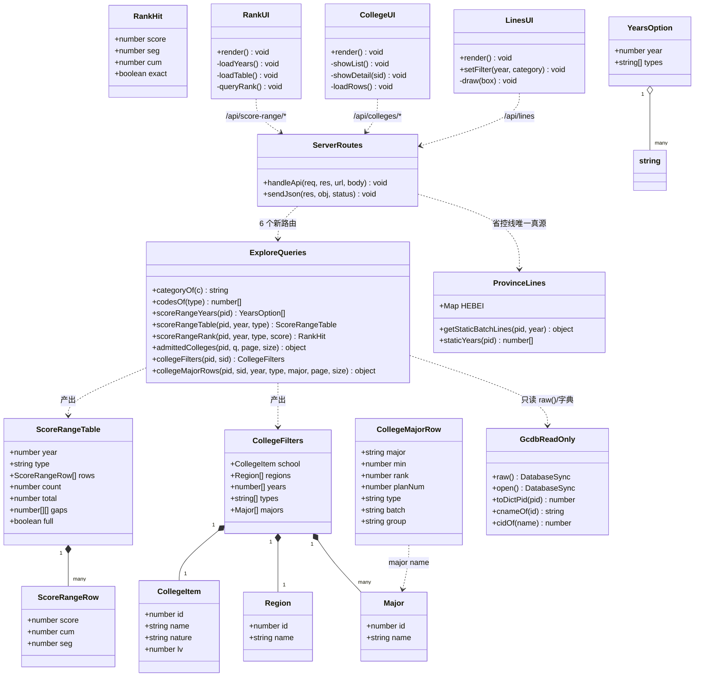
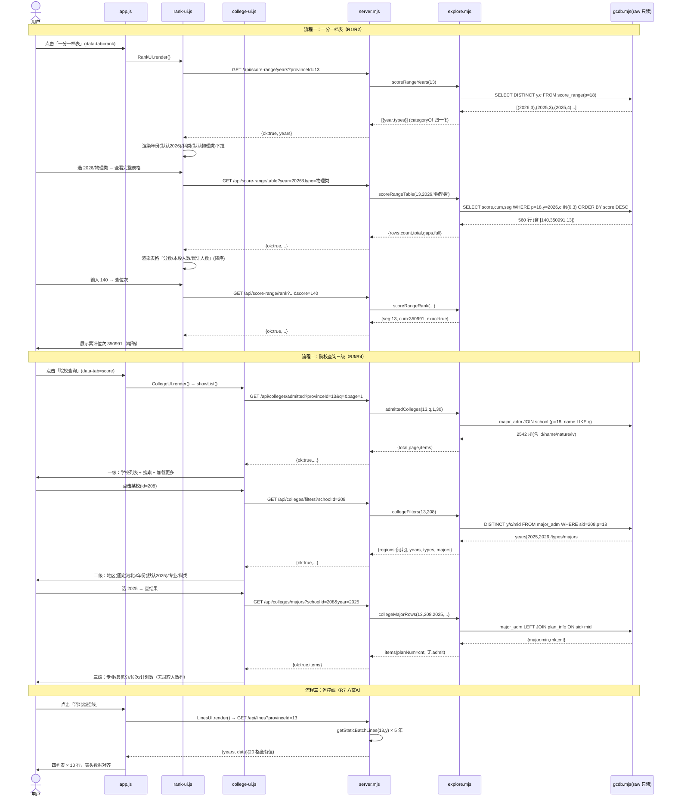
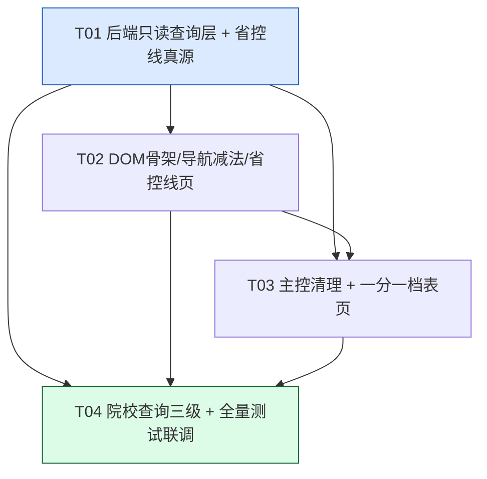

# 高考志愿助手 · 界面改版 v3 系统设计与任务分解

| 项 | 内容 |
| --- | --- |
| 文档语言 | 中文 |
| 项目代号 | `gaokao_zhiyuan_ui_v3`（v2 之上的增量改版） |
| 架构师 | 高见远（Bob） |
| 唯一需求依据 | `deliverables/software-company/ui-v3-prd.md`（246 行） |
| 技术栈 | **沿用**：原生 HTML/CSS/JS（`web/`）+ Node.js `.mjs`（`node:sqlite`、零第三方依赖），无构建、无框架 |
| 适用形态 | 单用户、纯本地部署、数据不外传 |
| 文档状态 | 定稿，供工程师执行 |

> 本设计只描述 v3 变更；未提及部分沿用 v2 现状（见 `ui-v2-architecture.md`）。凡与用户拍板口径冲突处，以口径为准。

---

## 一、实现方案总述与技术选型

### 1.1 核心结论（先看这里）

| 决策项 | 结论 | 理由 |
| --- | --- | --- |
| 框架 | **不引入任何框架/构建工具**，全部原生 | PRD 明确"沿用原生技术栈"；8 个功能页 DOM/事件已稳定，重构得不偿失 |
| 两个新页面 | **新增** `web/rank-ui.js`（一分一档表）、`web/college-ui.js`（院校查询三级）；复用 panel id | 两页均为全新增量交互，塞进现有 `plan-ui.js` 会放大失效风险；保持 `panel-score`/`panel-lines` id 不变可复用 app.js 的 `[data-tab]` 映射 |
| 后端端点 | **必须新增 6 个只读端点**（封装在新增 `server/explore.mjs`），**不改** gcdb.mjs / 现有端点 | 现有 `/api/resource/rank` 按 `cidOf('物理类')=3` 查询，**读不到 2020–2024（库内 c=0）的数据**；`/schools`、`/score/special` 都不满足"有录取记录的学校 + 计划数 + 专业录取行"三要素。详见 §3.4 复用评估 |
| R1 科类映射 | **确定性规则**：`c∈{0,3}→物理类`、`c∈{1,4}→历史类`（铁证见 §4），统一走新模块 `categoryOf()`，**不依赖 `cnameOf`**（它对 c=0 返回 null、对 c=1 返回 `<NA>`） | 实测 `score_range` 河北 2020–2024 用 0/1、2025 用 3/4、2026 仅 3；`cnameOf` 会把早期年份标成 `<NA>` 并丢失 c=0 整组 |
| R2 2026 仅物理类 | 年/科类下拉由 `/api/score-range/years` 按库内真实 `DISTINCT y,c` 生成；2026+历史类返回"暂无数据" | 库内 2026 只有 c=3（物理类），不插值、不造假 |
| R3 地区维度（已拍板） | **生源地省份语义**；院校查询地区下拉**默认且仅"河北"一项**（控件保留，值固定 13） | 主理人已拍板；`school.province` 约 360/5354 有值，按院校所在地筛不可用 |
| R4 录取人数 | **不显示、不返回、不编造**。三级结果表只有 4 列：专业 / 最低分 / 位次 / 计划数 | 实测 `major_adm` 表结构仅 `p,y,c,b,sid,mid,grp,min,rnk`，**连代码里写的 `admit` 列都不存在**（`r.admit` 为 undefined），铁证无此字段 |
| R5 删 `#q-banner`（已拍板） | **全局删除该 DOM 容器**，`quality-ui.js` 一字不改 | `quality-ui.js:118-119` 有 `if(!banner) return` 守卫；`boot()` 中 `init()` 与 `renderPanel()` 分开调用，横幅删除后质量面板仍由 `renderPanel()` 独立渲染（详见 §6.2） |
| R7 省控线表头（已拍板方案 A） | 四列 `年份 / 科类 / 本科批 / 专科批`，每年展开历史/物理各一行共 **10 行、20 格全有值** | 一举满足"补全物理类可见"与"表头数据对齐"；`gcsource` hook 不改 |
| 算法与数据 | `plan.mjs`/`recommend.mjs`/`gcdb.mjs`/`quality-*`/数据库原始数据**零改动**；新增端点只读 | 强约束；新增查询走 `gc.raw()` 只读连接，不改只读层源码 |

### 1.2 技术挑战与方法

| 挑战 | 处理方法 |
| --- | --- |
| 早期年份科类编码与字典不一致，现有换分端点静默失效 | 新增 `explore.mjs::categoryOf/codesOf` 归一化映射，直接对 `score_range.c` 做 `IN` 查询，绕开 `cidOf`；不改 gcdb.mjs |
| 删 DOM 触发 `app.js`/`plan-ui.js` 空引用**链式崩溃** | 精确定位并删除/加守卫（§6.2）：`refreshDict('r')`、`bindEvents` 的 `s-*`/`r-*` 绑定、`$('#s-hint')` 赋值、`plan-ui.js` 的资料库 5 函数与绑定、`bootExtra` 中的 `initResource()` 调用 |
| 计划数没有年份维度 | 瘦库 `plan_info(sid,mid,cnt,...)` 主键仅 sid+mid，按 `sid+mid` LEFT JOIN `major_adm` 取值（与 `gcdb.planCodes` 瘦库分支一致）；前端如实标注"计划数"，不冒充录取人数 |
| 校名 id 体系不通用 | 院校查询全程用 **gcdb 库内 `school.id`（sid）**，与 `data.mjs` 的 `schools.json` id 不同体系；实测河北 2542 个有 `major_adm` 的 sid **100% 能关联到校名** |
| 现有测试断言与新需求直接冲突 | 明确标注为**预期断言更新**（非回归），逐条给出新断言（§8.2）：省控线"缺键"断言、渲染测试"外链原样打开"断言 |
| `score_range` 缺分段/gaps | 查位次命中区间边界按保守语义取下一档 `cum` 并标 `exact:false`；分数正好命中行标 `exact:true`；不插值 |

### 1.3 架构分层（沿用 v2，仅加两个模块）

```
web/  index.html ── app.js(主控/[data-tab]) ── plan-ui(志愿参考/AI/收藏) / auth-ui / history-ui / draft-ui / quality-ui
                                            ├── lines-ui(省控线·方案A)   ← 改
                                            ├── rank-ui(一分一档表·新)   ← 新增，挂 window.RankUI
                                            └── college-ui(院校查询三级·新) ← 新增，挂 window.CollegeUI
                             │ fetch(/api/*, credentials:same-origin)
server/ server.mjs(路由) ── explore.mjs(新·只读查询封装: 一分一档 + 院校三级) ── gcdb.mjs(raw()/字典, ★不改★)
        ├── province-lines.mjs(省控线唯一真源·补全20格) ── gcsource.mjs::batchLines(hook★不改★)
        └── 既有算法层 plan/recommend/quality ★不改★
data/  gaokao.db（原始数据 ★不改★）
```

---

## 二、文件清单（相对路径：`D:/AAAProject/AAAgithub/zhiyuan/`）

### 2.1 新增文件

| 文件 | 模块 | 职责 | 性质 |
| --- | --- | --- | --- |
| `高考志愿助手/server/explore.mjs` | 后端·只读查询 | `categoryOf/codesOf` 科类归一化；一分一档年表/分段/分数→位次；院校列表/筛选项/专业录取行(含计划数)。复用 `gcdb.raw()` 只读连接与字典，不改 gcdb.mjs | 新增（**核心新增**） |
| `高考志愿助手/web/rank-ui.js` | 前端·一分一档表 | 年份/科类筛选、查位次、完整分段表；数据全部来自本地 `/api/score-range/*`，零外链；挂 `window.RankUI` | 新增（**必须**） |
| `高考志愿助手/web/college-ui.js` | 前端·院校查询 | 三级下钻：学校列表(搜索/加载更多)→详情筛选(地区/年份/专业/科类)→结果表(专业/最低分/位次/计划数)；挂 `window.CollegeUI` | 新增（**必须**） |
| `deliverables/software-company/ui-v3-class-diagram.mermaid` | 设计产物 | 本文 §5 类图摘出 | 新增（设计稿，非源码） |
| `deliverables/software-company/ui-v3-sequence-diagram.mermaid` | 设计产物 | 本文 §7 时序图摘出 | 新增（设计稿，非源码） |

### 2.2 修改文件

| 文件 | 模块 | 改动性质 | 具体职责 |
| --- | --- | --- | --- |
| `高考志愿助手/server/server.mjs` | 后端·入口 | **改（唯一新增路由点）** | import `explore.mjs`；新增 6 个只读 GET 路由（§3.2）；省控线 `/api/lines` 逻辑不动（真源补全后自动生效）；不动任何算法分派与鉴权门禁 |
| `高考志愿助手/server/province-lines.mjs` | 后端·省控线 | 改（**R7 落点**） | HEBEI 表补全物理类 10 个缺失格 → 5 年×2 科类×2 批次 = 20 格全有值；导出函数签名不变；hook 不改 |
| `高考志愿助手/web/index.html` | 前端·入口 | **改（T02 独占全部 DOM 改造）** | 删 `panel-recommend`+入口、`panel-resource`+入口、`#q-banner`、`#nav-onepoint` 外链；`<a id="nav-onepoint">` 换为 `<button data-tab="rank">`；`panel-score` 内改三级容器（保留 id）；新增 `panel-rank`；新增 2 个脚本引用；省控线面板结构保持由 lines-ui 渲染 |
| `高考志愿助手/web/styles.css` | 前端·样式 | 改（追加+可选清理） | 追加 `.college-*` / `.rank-*` / 面包屑 / 加载更多样式；**可选**清理 `.q-banner` 相关规则（223–229、317、144 中的 `.q-banner` token）；`@media print` 整段不动 |
| `高考志愿助手/web/lines-ui.js` | 前端·省控线 | 改（R7+E2） | 删 `YI_FEN_YI_DANG_URL` 常量与 `init()` 外链绑定及调用；`draw()` 重写为方案 A 四列 10 行；保留 `render`/`setFilter`（`setFilter` 兼容 category 参数但方案 A 忽略它，避免测试/调用破坏） |
| `高考志愿助手/web/app.js` | 前端·主控 | 改（**链式清理重点**） | 删 `refreshDict('r')`；删 `s-*`/`r-*` 事件绑定与 `#s-hint` 赋值（或加守卫）；`[data-tab]` 钩子新增 `rank`→`RankUI.render()`、`score`→`CollegeUI.render()`；省份 id 列表移除 `r-province`/`cd-province` |
| `高考志愿助手/web/plan-ui.js` | 前端·方案 | 改（**R6 失效清理**） | 删 `RES` 常量、`initResource`/`refreshRankOptions`/`queryRankScore`/`showRankTable`/`provinceIdOf`/`queryCodes` 六函数、`bindExtra` 中资料库绑定段、`bootExtra` 中 `initResource()` 调用；志愿参考/AI/收藏/大学环境逻辑一字不动 |
| `tools/api-test.mjs` | 测试 | 改 | 新增 6 端点用例；**更新省控线 20 格断言**（原 294–295"缺键"断言改为全有值） |
| `tools/render-test.mjs` | 测试 | 改 | **重写**原 647–666 外链/省控线用例为方案 A；新增一分一档/院校三级/DOM 删除无报错用例；新增静态文件校验两个新 js |

### 2.3 明确"不改"清单（强约束，diff 佐证）

`server/plan.mjs`、`server/recommend.mjs`、`server/gcdb.mjs`、`server/quality-core.mjs`、`server/quality.mjs`、`web/quality-ui.js`、`server/gcsource.mjs`（hook）、`server/resources.mjs`、`server/data.mjs`、`data/` 下全部原始数据文件；登录/历史/草稿/收藏功能；`/api/recommend` 接口；不 commit、不 push。

> 说明：新增端点**调用** gcdb.mjs 的导出函数（`raw()`/`toDictPid()`/`cnameOf()` 等）属于只读复用，不修改其源码，符合强约束。

---

## 三、后端 API 契约

### 3.1 通用约定

- 前缀 `/api/*`；路由在 `handleApi()` 中按现有 `p = url.pathname.replace(/^\/api/,'')` + 字符串/正则匹配风格新增；参数 `q = {...query, ...body}` 沿用现状。
- 响应沿用现有 `sendJson(res, obj, status)` 风格 `{ ok:true, ... }` / `{ ok:false, message:'...' }`；**不引入 `{code,data,message}` 信封**。
- 本次 6 个端点**全部只读、零鉴权、零联网**（个人本地数据）；参数缺失 400、无数据 `ok:false` 或空数组 + 提示；沿用现有错误语义。
- 全部固定河北：省码用 `PROVINCE_ID 13`，库内 `toDictPid(13)=18`（实测确认）。
- 所有查询经 `explore.mjs`，内部 `gc.open()` 后 `gc.raw().prepare(sql).all(...)`，只读，不加写语句。

### 3.2 新增端点表

| # | 路径 | 方法 | 参数 | 响应结构 | 鉴权 |
| --- | --- | --- | --- | --- | --- |
| 1 | `/api/score-range/years` | GET | `provinceId=13` | `{ ok:true, province:'河北', provinceId:13, years:[{ year:2026, types:['物理类'] }, { year:2025, types:['物理类','历史类'] }, ...] }`（倒序；由 `DISTINCT y,c` 经 `categoryOf` 归一化、去重、科类固定排序物理类在前） | 否 |
| 2 | `/api/score-range/table` | GET | `provinceId=13`, `year`, `type`（物理类/历史类） | `{ ok:true, province, year, type, rows:[[score,cum,seg],...]（分数降序）, count, total（=末行 cum）, gaps, full }`；无数据返回 `{ ok:false, message:'暂无数据' }` | 否 |
| 3 | `/api/score-range/rank` | GET | `provinceId=13`, `year`, `type`, `score` | `{ ok:true, year, type, score, seg, cum, exact }`；命中表内分数行 `exact:true`；落在缺分段 `exact:false` 且取下一档 cum（保守）；超上/下界 `exact:false` 取边界 cum；无表 `ok:false` | 否 |
| 4 | `/api/colleges/admitted` | GET | `provinceId=13`, `q?`, `page?`, `size?` | `{ ok:true, total, page, size, items:[{ id(sid), name, nature, lv }] }`；来源 = 河北有 `major_adm` 记录的学校（实测 2542 所）JOIN `school` 取名，`q` 对 name 做 LIKE，默认 size=30/上限 100 | 否 |
| 5 | `/api/colleges/filters` | GET | `provinceId=13`, `schoolId` | `{ ok:true, school:{id,name,nature,lv}, regions:[{id:13,name:'河北'}], years:[2025,2026]（倒序）, types:['物理类','历史类'], majors:[{id,name}] }`；years/types/majors 均由该校 `major_adm` DISTINCT 生成 | 否 |
| 6 | `/api/colleges/majors` | GET | `provinceId=13`, `schoolId`, `year`, `type?`, `major?`, `page?`, `size?` | `{ ok:true, total, page, size, items:[{ major, min, rank, planNum, type, batch, group }] }`；`planNum` 来自 `plan_info.cnt`（LEFT JOIN sid+mid，无值 null）；**不含 admit/录取人数字段**；`type`/`major` 可选过滤 | 否 |

> `/api/lines?provinceId=13`（v2 已存在）**行为不变**，仅真源数据补全；返回结构、缺键语义、鉴权均不变。省控线端点无需新增。

### 3.3 关键查询实现要点（`server/explore.mjs`，可直接照抄的结构）

```js
import { open, raw, toDictPid, cnameOf, cidOf } from './gcdb.mjs';

// —— R1 确定性科类归一化（铁证见设计文档 §4）——
const categoryOf = (c) =>
  c === 0 || c === 3 ? '物理类' :
  c === 1 || c === 4 ? '历史类' :
  c === 5 ? '理科' : c === 6 ? '文科' : null;
const codesOf = (type) =>
  type === '物理类' ? [0, 3] : type === '历史类' ? [1, 4] :
  type === '理科' ? [5] : type === '文科' ? [6] : [];

const db = () => { open(); return raw(); };

export function scoreRangeYears(pid) {           // 端点 1
  const p = toDictPid(pid);
  const rows = db().prepare('SELECT DISTINCT y, c FROM score_range WHERE p=? ORDER BY y DESC').all(p);
  const map = new Map();
  for (const r of rows) {
    const t = categoryOf(r.c); if (!t) continue;         // 未知科类不展示
    if (!map.has(r.y)) map.set(r.y, new Set());
    map.get(r.y).add(t);
  }
  const order = { 物理类: 0, 历史类: 1, 理科: 2, 文科: 3 };
  return [...map.entries()].map(([year, s]) => ({
    year, types: [...s].sort((a, b) => order[a] - order[b]),
  }));
}

export function scoreRangeTable(pid, year, type) { // 端点 2
  const p = toDictPid(pid), codes = codesOf(type);
  if (!codes.length) return null;
  const rows = db().prepare(
    'SELECT score, cum, seg FROM score_range WHERE p=? AND y=? AND c IN (?,?) ORDER BY score DESC'
  ).all(p, Number(year), ...codes);
  if (!rows.length) return null;
  const flat = rows.map((r) => [r.score, r.cum, r.seg]);
  const gaps = [];
  for (let i = 1; i < flat.length; i++) if (flat[i-1][0] - flat[i][0] > 1) gaps.push([flat[i-1][0]-1, flat[i][0]+1]);
  return { rows: flat, count: flat.length, total: flat[flat.length-1][1], gaps, full: gaps.length === 0 };
}

export function scoreRangeRank(pid, year, type, score) { // 端点 3
  const t = scoreRangeTable(pid, year, type); if (!t) return null;
  const s = Number(score), ser = t.rows;
  const top = ser[0], bot = ser[ser.length - 1];
  if (s >= top[0]) return { ...top, seg: top[2], cum: top[1], exact: false };
  if (s <= bot[0]) return { seg: bot[2], cum: bot[1], exact: false };
  for (let i = 1; i < ser.length; i++) {
    if (s >= ser[i][0]) { const hit = ser[i]; return { seg: hit[2], cum: hit[1], exact: hit[0] === s }; }
  }
  return null;
}
```

```js
// —— 院校查询三级（端点 4/5/6）——
export function admittedColleges(pid, q, page, size) { /* major_adm JOIN school，DISTINCT sid，count 分页 */ }
export function collegeFilters(pid, sid) { /* DISTINCT y/c/mid → years/types/majors；regions 固定河北 */ }
export function collegeMajorRows(pid, sid, year, type, major, page, size) {
  // major_adm ma JOIN dict(mid→name) LEFT JOIN plan_info pi ON pi.sid=ma.sid AND pi.mid=ma.mid
  // WHERE ma.p=? AND ma.sid=? AND ma.y=? [AND ma.c IN codesOf(type)] [AND mname LIKE ?]
  // SELECT mname, ma.min, ma.rnk, pi.cnt AS planNum, cnameOf(ma.c) AS type, bnameOf(ma.b) AS batch, gnameOf(ma.grp) AS group
  // 按 min 升序 / 分页；返回字段不含 admit
}
```

### 3.4 现有端点复用评估（为什么必须新增）

| 现有能力 | 能否满足 | 结论 |
| --- | --- | --- |
| `GET /api/resource/rank?year&type` → `gcdb.rankTable()` | **否** | 内部用 `cidOf(type)`：`物理类→c=3`。实测 `rankTable(18,2024,'物理类')=null`（2024 库内是 c=0，`WHERE c=3` 查不到）。2020–2024 五年全部读不到物理/历史数据；`availableRank` 又把 c=0 整组丢弃、c=1 标成 `<NA>`。**这是必须新增一分一档端点的决定性理由** |
| `GET /schools`（`data.mjs::searchSchools`） | 否 | 来自 `schools.json`（全国 5354 所、`province` 多空），不是"有河北 `major_adm` 记录的学校"，违反 C5 验收标准 2 |
| `GET /score/special`（`schoolSpecialScores`） | 否 | 口径是投档线/上游专业线，走 `index`/联网，无 `plan_info.cnt` 计划数，且非 `major_adm` 录取行 |
| `gcdb.provinceMajor(pid,year)` | 否 | 含 rnk 但**不含校名、不含计划数**（48641 条裸行），且无分页/过滤 |
| `gcdb.schoolMajorAdmission(sid,pid,years)` | 否 | 含 major/min/rnk，但**无 planNum、无校名**；`admit` 字段实际为 undefined（表里无此列） |

> 因此：`server/resources.mjs`、gcdb.mjs、现有端点**全部保留不改**（api-test 中广东 `/api/resource/*` 用例继续通过，无回归）；新需求由 6 个新只读端点承载。

---

## 四、R1 科类映射确定性方案（实测铁证，非猜测）

### 4.1 源码层事实

- `gcdb.mjs:162-163`：`cidOf(name) = D.category.byName.get(name)`、`cnameOf(id) = D.category.byId.get(id)`，字典来自 `dict(t='category')`。
- 实测 `dict(t='category')`：`0 不存在`（`cnameOf(0)=null`）、`1=<NA>`、`2=综合`、`3=物理类`、`4=历史类`、`5=理科`、`6=文科`。
- 实测河北 `score_range(p=18)` 的 `(year, c, 行数, 最高分, 累计总数)`：

| 年份 | c=0（行数/最高分/总数） | c=1（行数/最高分/总数） | c=3 | c=4 |
| --- | --- | --- | --- | --- |
| 2020 | 570 / 708 / 261,461 | 529 / 667 / 175,891 | — | — |
| 2021 | 523 / 661 / 202,096 | 554 / 692 / 216,153 | — | — |
| 2022 | 541 / 680 / 297,622 | 516 / 655 / 194,469 | — | — |
| 2023 | 552 / 691 / 335,207 | 525 / 664 / 240,794 | — | — |
| 2024 | 547 / 688 / 384,418 | 531 / 672 / 243,679 | — | — |
| 2025 | — | — | 554 / 693 / 363,040 | 534 / 673 / 243,714 |
| 2026 | — | — | 560 / 700 / 350,991 | — |

### 4.2 三条独立证据链（交叉验证）

1. **省控线 ctrl 直接锚定（最强）**：实测河北 2025 `score_range` 中 `c=3,b=2(本科批) ctrl=459`、`c=4,b=2 ctrl=477`。与 PRD C4 目标数据"2025 物理类本科批=459、历史类本科批=477"**逐格吻合** → `dict` 的 `3=物理类、4=历史类` 在本库成立。
2. **考生规模连续性**：2024 `c=1` 累计总数 **243,679** ≈ 2025 `c=4`（历史类）**243,714**（差 35，同一量级且历史类人数稳定）；2024 `c=0` **384,418** ≈ 2025 `c=3`（物理类）**363,040**（物理类考生远多于历史类）→ `c=0` 对应物理类、`c=1` 对应历史类。
3. **最高分连续性**：2024 `c=0` 最高 688 / `c=1` 最高 672；2025 `c=3` 最高 693 / `c=4` 最高 673。物理类最高分始终更高，与证据 1/2 一致。

> 2021 年 `c=1` 总数（216,153）略高于 `c=0`（202,096）属该年数据本身特征，不改变由证据 1（ctrl 锚定）+ 证据 3（最高分）+ 其余 4 年规模共同确立的映射；且 PRD 已要求"统一走科类映射、无数据显示暂无数据"，本映射无需对 2021 做特殊插值。

### 4.3 落地规则（工程师照此实现，写入 `explore.mjs`）

```
categoryOf(c): c∈{0,3} → 物理类 ; c∈{1,4} → 历史类 ; c=5 → 理科 ; c=6 → 文科 ; 其他 → 不展示
codesOf(type): 物理类→[0,3] ; 历史类→[1,4] ; 理科→[5] ; 文科→[6]
```

- 所有一分一档查询用 `c IN codesOf(type)`，**绝不调用 `cnameOf` 生成前端科类**（否则早期年份变 `<NA>`、c=0 整组丢失）。
- 前端科类选项来自 `/api/score-range/years`，只会出现"物理类/历史类"（河北一分一档库无 5/6）；2026 年只有"物理类"（R2）。
- 不修改 `gcdb.mjs`；如后续需要，可将此映射上提为 gcdb 的导出函数，但本期在 `explore.mjs` 内实现以满足强约束。

---

## 五、导航重构与 DOM 删除清单

### 5.1 侧边栏（index.html）

```
志愿填报
├─ 📊 志愿参考                  data-tab="plan"（不变）
└─ [删除] 🧭 智能推荐            （删按钮 + 删 panel-recommend）
信息查询
├─ 📏 河北省控线                  data-tab="lines"（方案A四列表）
├─ 📊 一分一档表                  data-tab="rank"（原 <a id="nav-onepoint"> 外链 → 改为 button；新增 panel-rank）
├─ 🏫 院校查询                    data-tab="score"（panel-score 内改三级容器，id 不变）
├─ [删除] 📚 一分一段/代码        （删按钮 + 删 panel-resource）
├─ 🌳 大学环境                    data-tab="campus"（不变）
└─ 🤖 AI 助手                     data-tab="ai"（不变）
我的方案 / 系统                   （不变）
顶部 #q-banner                    （整块删除，全局无横幅）
```

### 5.2 精确删除/替换清单

| 文件 | 位置（现状行号） | 处理 |
| --- | --- | --- |
| index.html | 26 `<button data-tab="recommend">` | 删 |
| index.html | 139–171 `<section id="panel-recommend">` | 整段删 |
| index.html | 33 `<button data-tab="resource">` | 删 |
| index.html | 189–235 `<section id="panel-resource">` | 整段删（含 `#res-rank`/`#res-code`/`#res-hint`/`#rk-*`/`#cd-*`） |
| index.html | 51 `<div id="q-banner" class="q-banner wrap">…` | 整块删（R5 全局移除） |
| index.html | 31 `<a id="nav-onepoint" …>🔗 河北省一分一档表</a>` | 换成 `<button class="side-link" data-tab="rank">📊 一分一档表</button>` |
| index.html | 97–122 `<section id="panel-score">` 内表单 | 保留 `id`/`data-tab="score"`，内部换为院校三级容器（由 college-ui.js 渲染，形如 `<div id="college-content">`） |
| index.html | panel 区新增 | 新增 `<section id="panel-rank" class="panel"><div id="rank-content"></div></section>` |
| index.html | 脚本区 319–325 | 新增 `<script src="rank-ui.js"></script>`、`<script src="college-ui.js"></script>` |
| lines-ui.js | 3–4 `YI_FEN_YI_DANG_URL` 常量 | 删 |
| lines-ui.js | 21–29 `init()` 外链绑定、112 `init()` 调用 | 删（保留 `render`/`setFilter`） |
| plan-ui.js | 185 `RES` 常量；187–267 五函数；269–328 `queryCodes` | 全删 |
| plan-ui.js | 537–559 `bindExtra` 中资料库绑定段 | 删 |
| plan-ui.js | 588 `bootExtra` 中 `initResource()` 调用 | 删 |
| app.js | 143 `await refreshDict('r')` | 删（`r-province` 已删，否则空引用崩溃） |
| app.js | 125–127 `$('#s-hint').innerHTML = …` | 删或加 `if($('#s-hint'))` 守卫（panel-score 改容器后该 id 不存在） |
| app.js | 131/137 id 列表中的 `r-province`、`cd-province` | 移除（已有 `if(el)` 守卫，属整洁性清理） |
| app.js | 780–789 `s-*` 绑定、794–800 `r-*` 绑定 | 删（`s-search`/`r-run` 等已不存在，否则 `null.addEventListener` 崩溃） |
| styles.css | 223–229、317、144 中 `.q-banner` | 可选清理（DOM 删后样式无害，保持 `@media print` 整段不动） |

> **链式崩溃警示（PRD 未充分强调）**：`app.js` 的 `bindEvents()` 是一个函数，任一 `$('#已删id').addEventListener` 抛错会中断后续**全部**事件绑定（含收藏、数据管理）。因此 `s-*`/`r-*` 绑定必须删除而非仅留 DOM。`plan-ui.js::bootExtra` 的 `initResource()` 同理必须删调用。`quality-ui.js` **不改**（见 §6.2）。

### 5.3 app.js 的 `[data-tab]` 适配（保留原映射策略）

```js
$$('[data-tab]').forEach((b) => b.addEventListener('click', () => {
  if (b.dataset.auth === '1' && !window.AuthUI?.isAuthenticated()) { window.AuthUI?.promptLogin(); return; }
  $$('[data-tab]').forEach((x) => x.classList.toggle('active', x === b));
  $$('.panel').forEach((p) => p.classList.toggle('active', p.id === 'panel-' + b.dataset.tab));
  if (b.dataset.tab === 'wishlist') renderWishlist();
  if (b.dataset.tab === 'data') renderData();
  if (b.dataset.tab === 'lines') window.LinesUI?.render();
  if (b.dataset.tab === 'rank') window.RankUI?.render();        // 新增
  if (b.dataset.tab === 'score') window.CollegeUI?.render();    // 新增：覆盖旧 runScoreQuery 入口
  if (b.dataset.tab === 'history') window.HistoryUI?.render();
  if (b.dataset.tab === 'drafts') window.DraftUI?.render();
}));
```

关键点：① 原 `p.id === 'panel-' + b.dataset.tab` 约定**完全不变**；② `score` 由旧查询改为 `CollegeUI.render()`；③ 原 `runScoreQuery`/`renderScoreResult`/`loadTrend`/`tierTag`/`lineChart`（app.js 174–369）随绑定删除成为死代码，可一并删（保持文件整洁，需与 §5.2 绑定删除同批次完成）。

### 5.4 省控线方案 A 渲染规则（lines-ui.js::draw）

- 表头固定四列：`<th>年份</th><th>科类</th><th>本科批</th><th>专科批</th>`。
- 数据：5 年 × 2 科类 = **10 行**，每年先历史类后物理类；每行三格 `年/科类/本科/专科`，20 个数值格**全部有值**（真源补全后无缺键）。
- 数据源 `GET /api/lines?provinceId=13` 的 `data[year]['科类|批次']`；取值即显示数字，**本方案不再出现"暂无数据"**。
- 保留年份下拉（全部/某年）；科类下拉可移除（因为两行都展开）——若保留则 `setFilter(year, category)` 对 category 做兼容忽略，不改外部调用签名。
- 严禁前端写死第二份表、严禁插值。

---

## 六、数据模型与关键代码结构

### 6.1 类图



### 6.2 三块关键数据结构（TS 风格）

```ts
// 一分一档分段行：端点 2 的 rows 元素，顺序固定 [score, cum, seg]
type ScoreRangeRow = [score: number, cum: number, seg: number];
// 样本：河北 2026 物理类 → [140, 350991, 13]（本段人数 13 / 累计位次 350991）
interface RankHit { score:number; seg:number; cum:number; exact:boolean; }

// 院校列表项（端点 4）—— 来自有 major_adm 的河北学校
interface CollegeItem { id:number /*gcdb 库内 sid*/; name:string; nature:string; lv:number; }

// 专业录取行（端点 6）—— 三级结果表数据源，无录取人数字段
interface CollegeMajorRow {
  major:string;     // dict(t='major').v，无字典名显示原始值/「—」
  min:number;       // major_adm.min
  rank:number|null; // major_adm.rnk，2025 全带；无值「—」
  planNum:number|null; // plan_info.cnt（LEFT JOIN sid+mid），无值「—」，明确是「计划数」
  type:string; batch:string; group:string;
}
// 结果表四列固定：专业 / 最低分 / 位次 / 计划数（不出现录取人数列）
```

### 6.3 质量面板为何不受横幅删除影响（R5 论证）

`quality-ui.js:279`：`boot = () => { init(); renderPanel(); }`，两调用**相互独立**。
- `init()` 取 `document.getElementById('q-banner')`，容器删除后 `if(!banner) return` 立即返回（不再填充横幅、不再绑 `#q-banner-detail`）——无异常。
- `renderPanel()` 取 `#q-panel-root`（位于 `panel-data` 内，未删），独立请求 `/quality/freshness` + `/quality/manifest` 并渲染质量面板——**正常**。
- 结论：删横幅只让 `init()` 空转，数据管理页质量面板照常渲染；符合强约束"不改 quality-ui.js"。

---

## 七、程序调用流程（时序图）



---

## 八、有序任务列表（给工程师）

> 共 **4 个任务**，按依赖排序；每个任务涉及的文件互不重叠，**同文件只在一个任务里写**。T02 依赖 T01 的运行端点；T03 依赖 T02 的 DOM 骨架；T04 依赖 T01 端点 + T03 挂载的 tab 钩子。任何时刻同一文件只有一个任务在写。

### T01 · 后端只读查询层与省控线真源（P0，无依赖）

- **文件**：`server/explore.mjs`（新）、`server/server.mjs`（改）、`server/province-lines.mjs`（改）
- **要点**：
  - `explore.mjs` 按 §3.3 实现 8 个导出函数；科类归一化严格用 §4.3 规则，不调用 `cnameOf` 生成前端科类。
  - `server.mjs` import explore 并新增 6 个 GET 路由（§3.2）；不动鉴权门禁、不动算法分派、`/api/lines` 逻辑不改。
  - `province-lines.mjs` HEBEI 补全为 20 格：2026 史485/200 物443/200；2025 史477/200 物459/200；2024 史449/200 物448/200；2023 史430/200 物439/200；2022 史443/200 物430/200。导出签名不变。
- **验收点**：① `/api/score-range/years?provinceId=13` 返回 years 含 2026(types=['物理类'])、2025(types=['物理类','历史类'])、2020–2024(types 历史/物理)；② `/api/score-range/table?provinceId=13&year=2026&type=物理类` 的 rows 含 `[140,350991,13]`；③ `/api/score-range/rank?...&score=140` 返回 `cum=350991,seg=13,exact:true`；④ `/api/colleges/admitted?provinceId=13` total≈2542、校名非空；`/api/colleges/filters?schoolId=208` regions 仅河北；`/api/colleges/majors?schoolId=208&year=2025` 有 planNum 且**无 admit 字段**；⑤ `/api/lines?provinceId=13` 20 格全有值，物理 2024/2023/2022 本科=448/439/430、专科五年=200；⑥ `git diff` 中 gcdb/plan/recommend/quality/gcsource/data 零改动。

### T02 · DOM 骨架、导航减法与省控线页（P0，依赖 T01）

- **文件**：`web/index.html`（独占）、`web/styles.css`（改）、`web/lines-ui.js`（改）
- **要点**：按 §5.2 完成全部删/换/新增 DOM；`panel-score`/`panel-lines` id 保留；`lines-ui.js` 删外链常量与 init 绑定，`draw()` 改方案 A；追加新样式，`@media print` 整段不动。
- **验收点**：① DOM 检索不到 `panel-recommend`/`data-tab="recommend"`/`panel-resource`/`data-tab="resource"`/`#q-banner`/`#nav-onepoint`/`#rk-*`/`#cd-*`；② 侧边栏含 `data-tab="rank"` 与 retained 8 项；③ 省控线页四列表头、10 行、20 格全有值、无"暂无数据"、无错位；④ `window.LinesUI.render/setFilter` 仍可用；⑤ 无夸克链接残留。

### T03 · 主控清理与一分一档表页（P0，依赖 T01、T02）

- **文件**：`web/app.js`（改）、`web/plan-ui.js`（改）、`web/rank-ui.js`（新）
- **要点**：
  - `app.js` 按 §5.2/§5.3 删除 `refreshDict('r')`、`s-*`/`r-*` 绑定、`#s-hint` 赋值、旧 `runScoreQuery` 等死代码，新增 `rank`→`RankUI.render()`、`score`→`CollegeUI.render()` 钩子。
  - `plan-ui.js` 按 R6 删资料库 6 函数 + 绑定 + `initResource()` 调用；志愿参考/AI/收藏逻辑一字不动。
  - `rank-ui.js` 实现年份/科类筛选、完整表格、查位次（含 `exact` 标注）；数据全部来自 `/api/score-range/*`，零外链；缺数据显示"暂无数据"。
- **验收点**：① 逐页点击剩余导航项，浏览器控制台**无** `null.addEventListener`/`Cannot read properties of null` 报错（这是链式崩溃重点）；② 收藏/数据管理/AI/志愿参考功能正常；③ 一分一档页选 2026/物理类，表格含 `140 | 13 | 350991`，输入 140 查位次显示 350991；④ 选 2026/历史类显示"暂无数据"不报错；⑤ 表头与数据列对齐；⑥ 页面无外链跳转。

### T04 · 院校查询三级页 + 全量测试与联调（P0，依赖 T01、T02、T03）

- **文件**：`web/college-ui.js`（新）、`tools/api-test.mjs`（改）、`tools/render-test.mjs`（改）
- **要点**：
  - `college-ui.js` 实现三级下钻 + 面包屑 + 返回列表；结果表四列（专业/最低分/位次/计划数），**绝不出现录取人数列**。
  - 测试按 §8.2 更新：新增 6 端点用例；**改掉两条与新需求冲突的旧断言**；重写省控线渲染用例为方案 A。
- **验收点**：① 院校查询默认显示学校列表、可搜索收窄、列表仅来自有录取记录的学校；② 点击进详情后地区(仅河北)/年份/专业/科类筛选可用、切换即更新结果表；③ 结果表四列对齐、数据与 `major_adm` 一致、**无录取人数列/数值**；④ 可返回列表、控制台无错；⑤ `api-test.mjs` 与 `render-test.mjs` 全绿（117+/48+）；⑥ PRD 第八节 6 条验收清单逐条打勾。

### 8.1 任务依赖图



---

## 九、共享约定与测试策略

### 9.1 共享约定

| 类别 | 约定 |
| --- | --- |
| API 风格 | 新增端点 `/api/*`，沿用 `sendJson` + `{ok, ...}`；只读、零鉴权、零联网；参数缺失 400 |
| 省码 | 对外标准码 13（河北）；库内经 `toDictPid(13)=18`；地区下拉固定仅河北一项 |
| 科类 | 前后端统一 物理类/历史类 字符串；库内 c 经 `categoryOf` 归一化（0/3→物理，1/4→历史）；不用 `cnameOf` 出前端科类 |
| 一分一档行 | `rows` 元素顺序固定 `[score, cum, seg]`（分数/累计/本段），表格展示列"分数/本段人数/累计人数"，注意 seg 与 cum 的列位 |
| 查位次 exact | 命中表内分数 `exact:true`；缺分段/越界 `exact:false`，前端如实标注"估算/边界" |
| 省控线键 | `"科类\|批次"`，如 `"物理类\|本科批"`；方案 A 下 20 格全有值，不再渲染"暂无数据" |
| 计划数 | 来自 `plan_info.cnt`，按 sid+mid 关联；**明确标"计划数"，不冒充录取人数**；无值显示"—" |
| 校名 id | 院校查询全程用 gcdb 库内 `school.id`(sid)，与 `schools.json` id 不混用 |
| 命名 | 新前端模块 `*-ui.js` 挂 `window.<X>UI`；后端模块 kebab-case `.mjs`；panel id `panel-<tab>` |
| 强约束 | 不改算法/质量数学/数据库原始数据/登录历史草稿收藏；不改 gcdb/gcsource hook/quality-ui；不 commit/push |
| 测试执行 | 仓库根用 `高考志愿助手/runtime/node.exe tools/api-test.mjs` 与 `... tools/render-test.mjs` |

### 9.2 测试用例要点

**api-test.mjs（新增 + 断言更新）**

| 用例 | 要点 |
| --- | --- |
| 一分一档 years | 河北 years 倒序；2026.types=['物理类']；2020–2024 含物理类/历史类（不再有 `<NA>`） |
| 一分一档 table | 2026/物理类 rows 含 `[140,350991,13]`；count≈560；降序 |
| 一分一档 rank | 2026/物理类 score=140 → `cum=350991,seg=13,exact:true`；2026/历史类 → `ok:false` 或空 + "暂无数据" |
| 院校三级 | admitted total≈2542、name 非空、q 搜索收窄；filters regions 仅河北、years 含 2025/2026；majors 有 planNum、字段集**不含 admit/录取人数** |
| 省控线 20 格（**改旧断言**） | 原 294"物理类早年缺键"、295"物理类专科批五年全缺键"→ 改为：物理本科 2024/2023/2022=448/439/430、物理专科五年=200，20 格全有值；历史类断言不变 |
| 无回归 | 广东 `/api/resource/rank|codes`、`/api/recommend`、`/score/*` 等原有用例继续通过（端点未改） |

**render-test.mjs（重写 + 新增）**

| 用例 | 要点 |
| --- | --- |
| 省控线方案 A（**重写原 647–666**） | 删外链断言（不再读 `ui-v2-prd.md` 的夸克 URL、不再校验 `#nav-onepoint`）；改为调 `LinesUI.render()` 后断言四列表头 4 个 `<th>`、10 行 `<tr>`、20 个数字格、无"暂无数据"；`setFilter` 仍可调用不报错 |
| 一分一档页 | 假 DOM 下执行 rank-ui.js，断言渲染表头"分数/本段人数/累计人数"、样行为本 140/13/350991、查位次展示 350991；无外链常量 |
| 院校三级页 | 断言列表/详情/结果表三段渲染，结果表 `<th>` 恰为 专业/最低分/位次/计划数（**不含"录取人数"**） |
| DOM 删除无 JS 报错 | 加载 app.js + plan-ui.js 时捕获 console.error，断言无 `Cannot read properties of null`/`addEventListener` 异常（覆盖 §5.2 链式崩溃点） |
| 静态文件校验 | 原 374 行的静态文件列表加入 `/rank-ui.js`、`/college-ui.js`；断言 index.html 源码不含被删 token |
| 无回归 | 原有 48 项除被明确重写的省控线用例外全部通过 |

> **关于"无回归"的准确口径**：原有 117+48 项中，仅 2 条旧断言因需求变更（物理类补全、外链删除）**必须更新**，属预期变更而非回归；其余全部保持通过。`score_range` 2026 物理类分数 140→seg13/cum350991、省控线 20 格、院校三级、删项无 JS 报错，构成本次 4 个新增验收样本。

---

## 十、待明确事项

| # | 事项 | 本设计默认处理 | 是否阻塞 |
| --- | --- | --- | --- |
| 1 | 2021 年河北 `score_range` 科类规模 c=0/c=1 与相邻年份略有出入 | 由省控线 ctrl 锚定 + 最高分连续性确立映射（§4.2），不对 2021 做任何特殊插值；如实测某年科类反向，按"无数据显示暂无数据"处理，不强行纠正库数据 | 否（已有确定性方案） |
| 2 | `plan_info.cnt` 无年份维度，跨年共用一条计划数 | 按 sid+mid LEFT JOIN 取值（库结构限制），前端如实标"计划数"；不伪造逐年计划数 | 否（遵循不编造原则） |
| 3 | 院校查询"地区"仅河北一项是否显得多余 | 按主理人拍板**保留控件**、固定河北（R3）；如后续要按院校所在地筛，需先解决 `school.province` 缺失，不在本期范围 | 否（主理人已拍板） |
| 4 | 旧 `runScoreQuery` 等死代码是否必须物理删除 | 建议与绑定删除同批次删除以保持整洁；若时间紧，至少删除 `s-*`/`r-*` 绑定以杜绝空引用崩溃（物理删函数非必须） | 否 |
| 5 | 科类下拉在方案 A 省控线页是否保留 | 默认移除（两行已展开），但保留 `setFilter(year, category)` 签名兼容；如测试依赖可留空绑定 | 否 |

---

> 本设计与 PRD 冲突处以 PRD 为准；PRD 未明确处以本设计"核心结论/默认处理"为准。工程师如发现设计与实际代码有出入，先反馈架构师，**不得自行改动算法、质量数学、数据库原始数据或被列为强约束的文件**。
