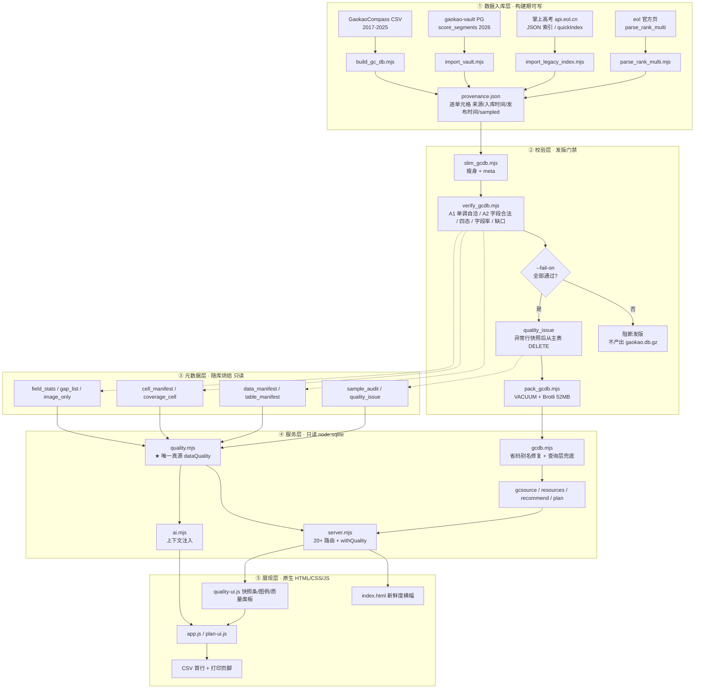
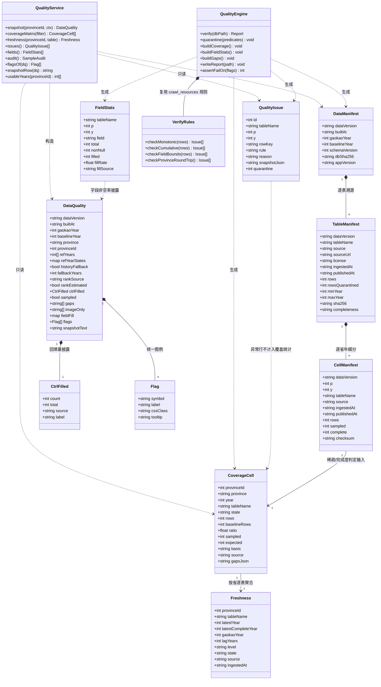
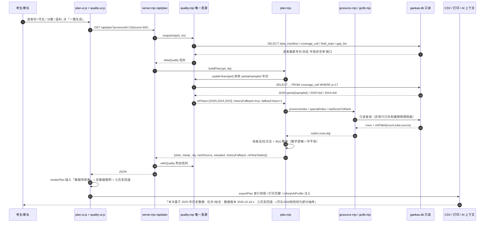
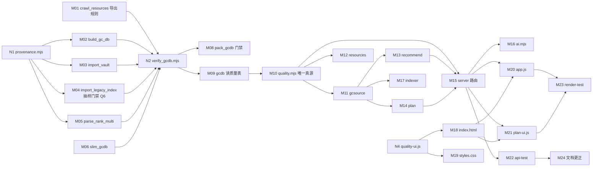
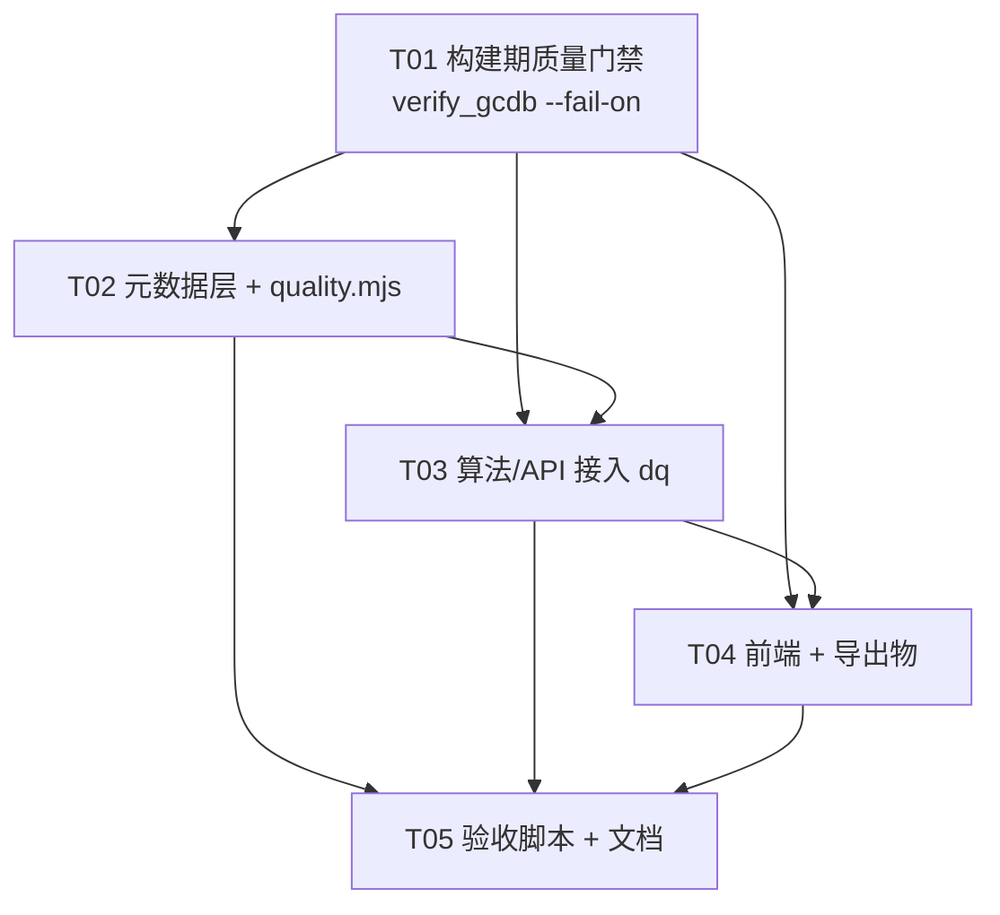

# 高考志愿助手 · 数据「准确 / 完整 / 时效」三位一体技术改善方案

> 架构师：高见远（Gao） · 输入：产品经理《数据质量增量 PRD》
> 项目根：`D:/AAAProject/AAAgithub/zhiyuan` · 复核方式：**逐文件读源码 + 随包 `gaokao.db` 只读 SQL 实测 + git log 溯源**
> 本文件只做设计，不改动任何运行代码。

---

## 决策记录（用户拍板 · 2026-11-18）

实施前由用户对 §7 / §10 的待确认项做出如下决定，作为实现期的强制口径：

| 编号 | 议题 | 决策 | 对实现的影响 |
|---|---|---|---|
| **U4 / Q6** | 河北 2026 抽样行如何处置 | **保留 + 标注 + 默认排除** | 不物理删除；`school_adm/major_adm` 2026 标为 `partial` 且 `sampled=1`，`usableYears()` 默认排除，不计入「完整覆盖」统计；质量面板可查 |
| **U5 / Q1** | 高考年度与复读 / 模考场景 | **不考虑复读 / 模考场景**，`gaokaoYear = 当前日历年` | 不做考试年度 6 月切分、不新增年份选择控件；`data_manifest.gaokaoYear` 由服务器当前年份给出；滞后分级一律以日历年为基准 |
| **Q4** | 异常数据隔离后是否展示 | **默认隐藏，但可在质量面板查** | 异常行不进候选集、不出现在查询结果与覆盖统计；`/api/quality/issues` + 质量面板「维护者详情」中可查可导出，含原始值快照 |
| **Q7 / U7** | 质量面板面向谁 | **默认给家长看精简版，维护者细节折叠** | 默认展示四态矩阵 + 新鲜度 + 图例 + 数据版本；异常清单 / 字段非空率明细 / 校验和 / 抽样比对台账放在 `<details>` 折叠区 |

其余 U1（NULL 不算不合法，仅隔离越界）、U2（首版只披露时延不告警）、U3（官方比对为构建期人工台账、运行时零联网）、U6（`baselineYear` 需显式指定）、U8（仅图片算「已如实标注缺失」但单独计数）沿用 §7 默认取值。

> 实现说明：本文档为设计基线；实际落地以源码为准，行号在改动后会漂移。实现清单与验收结果见 `.workbuddy/memory/2026-11-18.md`。

---

## 0. 源码复核结论（先于设计的事实基线）

我对 PRD 的事实基线做了独立复核，**全部成立**，并额外发现 3 项 PRD 未列出但会影响方案的关键事实。

### 0.1 只读实测（便携 `runtime/node.exe` v24.21.0 + `node:sqlite`，只读连接）

| 项 | PRD 值 | 实测值 | 结论 |
|---|---|---|---|
| `score_range` 2026 | 7 省 | **7 省 / 6,865 行**：广东1170、陕西1163、江西1160、河北1124、山东1096、重庆986、**山西仅166** | ✅ 一致，山西明显截断 |
| `school_adm` 2026 | 河北 1 省 1320 行 | **p=17 河北 1320 行，全国唯一** | ✅ |
| `major_adm` 2026 | 河北 1 省 4000 行 | **p=17 河北 4000 行，全国唯一** | ✅ |
| `plan_code` 2026 | 0 行 | **0 行**；全表年份 2023–2025 | ✅ |
| `school_adm.ctrl` 空/0 | 750203/757825（99%） | **750,203 / 757,825 = 98.99%** | ✅ |
| `school_adm.rnk` 空/0 | 322355/757825（42.5%） | **322,355 / 757,825 = 42.53%** | ✅ |
| `min` 越界 | school_adm 589 / major_adm 434 | **589 / 434**，复现口径为 `min>750 OR (min>0 AND min<100)` | ✅ 口径已复现 |
| `score_range.cum<=0` | 44 行 | **44 行，其中 2026 河北 30 行** | ✅ |
| 全库 `years` | `MIN/MAX(school_adm)=2017–2026` | 2017–2026；但 `plan_code` 只到 **2025** | ✅ 全库 MAX 会误读 |
| `meta` 表 | 无版本元数据 | **已存在 `meta(k,v)`，仅 3 键**：`builtAt=2026-10-18T00:41:59.339Z`、`minYear=2023`、`dropVocational=false` | ⚠ 有 `builtAt` 但**无版本号/逐表来源/行数/校验和**；可复用该表而非新建空壳 |

**额外发现（PRD 未列，必须纳入设计）**

1. **省份码双轨换算存在真实错配**（A-P4 的具体落地）：`dict` 省名 `1..31` 为标准码之外的自增 id，且库内省名为「**内蒙**」而非 `PROVINCES` 的「**内蒙古**」。模拟 `gcdb.mjs:54-59 toDictPid` 逐省回环：**标准码 15（内蒙古）→ 落到 dict id 15 = 四川**，其余 30 省正确。也就是说内蒙古的查询当前会**静默返回四川的数据**（`score_range p=15` 有 10,538 行，而真正的 `p=9 内蒙` 有 6,317 行）。另外 `dict 31 = 西藏` 在 `score_range` **0 行**，README「31 省全覆盖」并不成立。
2. **河北 2026 的 `school_adm`/`major_adm` 行「看起来很完整」**：1320 行 `ctrl>0` 占比 100%、`rnk>0` 占比 100%（样例 `min=695,rnk=83,ctrl=443`）。因此仅靠「字段非空率」无法识别其为抽样数据，必须靠**来源/完成度元数据**判定（C3）。
3. **2026 的 `score_range` 来源被按年份硬猜**：`resources.mjs:36` 用 `t.year>=2026 ? 'gaokao-vault' : 'GaokaoCompass'`。但 `parse_rank_multi.mjs` 写的是 **eol 官方页**的河北 2026 一分一段，来源标注必然错误。

### 0.2 Q6 证据链（定稿口径见 §7-Q6）

| 证据 | 位置 | 内容 |
|---|---|---|
| git `746c8ec` | 2026-10-18 09:00 | 「并入 gaokao-vault 抓取的 2026 一分一段数据（**6 省 5,193 行**）」，新增 `tools/import_vault.mjs` |
| git `7daf88f` | 同上 | 「补全 2026 一分一段（vault 抓取完成，**山东由 548 增至 1,096 行**）」→ 7 省 |
| git `b28cd18` | 09:32 | 「智能推荐精确到专业 + **河北 2026 数据** + 数据管理切新数据源」，**同批新增 `import_legacy_index.mjs`、`parse_rank_multi.mjs`** 并改 `gaokao.db.gz` |
| `import_vault.mjs:60-66,114-139` | — | 只 `SELECT ... FROM score_segments`，只 `INSERT INTO score_range`；**从不写** `school_adm/major_adm/plan_code` |
| `import_legacy_index.mjs:4-5,91-136` | — | 从 `data/index/province_<PID>_<YEAR>.json` 与 `special_<PID>_<YEAR>.json` 写 `school_adm`/`major_adm`；**用法示例即 `--province 13 --year 2026`（河北）** |
| `province_13_2026.json` | 交付目录 | `numFound=5772, complete=false, rows=1320` → 20.3% of 河北 2025（6490） |
| `special_13_2026.json` | 交付目录 | `numFound=10000, complete=false, **sampled=true**, rows=4000` → 8.2% of 河北 2025（48,641）；`sampled` 只由 `indexer.mjs:216 quickIndex` 写入 |
| `resources.mjs:36` / `gcsource.mjs:258` | — | 前者按年份猜来源；后者注释自述「某省 2026 只有抽样的两千行，2025 有四万多行」 |

> **结论**：2026 `score_range` 是**官方已发布的一分一段表（部分省份 / 部分分段）**；2026 `school_adm`/`major_adm`（河北）是**掌上高考 `api.eol.cn` 后台抽样 / 未完成抓取产物，不是官方 2026 投档线**，且 `plan_code` 全缺。二者必须分别标注，绝不合并为「有 2026」。

---

## 1. 方案总览

**一句话设计思路**：把「数据质量」从前端的一句免责声明，前移成**构建期可阻断的质量门禁 + 随库烘焙的只读元数据 + 服务端唯一真源的质量信封 + 全链路强制携带的灰数据标签**，让「准不准 / 全不全 / 新不新」在每一条结果、每一份导出物上都可见、可验、不可误用；**不新增依赖、不联网、不改算法数学、不填一个数**。

### 1.1 五层治理体系

| 层 | 职责 | 落地位置 | 何时执行 |
|---|---|---|---|
| ① 数据入库层 | 逐「省-年-表」记录来源 / 入库时间 / 官方发布时间 / `sampled`·`complete` 标志 | `tools/lib/provenance.mjs` + 4 个导入脚本 | 构建期（可写） |
| ② 校验层 | 字段级校验、异常隔离、四态矩阵、字段缺失率、缺口清单、机器可读报告、`--fail-on` 门禁 | `tools/verify_gcdb.mjs` | slim 之后 / pack 之前 |
| ③ 元数据层 | `data_manifest` / `table_manifest` / `cell_manifest` / `coverage_cell` / `field_stats` / `quality_issue` / `gap_list` / `image_only` / `sample_audit` —— **烘焙进同一个 `gaokao.db`** | DB 内小表 | 构建期写入，运行时只读 |
| ④ 服务层 | `quality.mjs` 单一真源 → 所有 API 附加统一 `dataQuality` 信封；`rankSource`/`sampled`/`ctrlFilled`/`historyFallback` 统一 | `server/*.mjs` | 运行时（只读 `node:sqlite`） |
| ⑤ 展现层 | 首页新鲜度横幅、结果快照条、四态矩阵面板、灰数据图例、CSV 首行 / 打印页脚 | `web/*` | 浏览器 |

### 1.2 数据流 + 质量关卡全景图



**三个硬关卡**：`G1` 发版门禁（A1/A2/A4/C1/C2/C3/C4/T2）、`B3` 抽样并入门禁（Q6 根因）、`E1` 运行时只读兜底过滤。

---

## 2. 现状架构的差距分析（指标 → 文件 / 函数级定位）

| 指标 | 现状缺失的质量关卡 | 文件:行 / 函数 |
|---|---|---|
| A1 一分一段单调自洽 100% | `verify` 只跑备用 `rank_table.json`，主库 `score_range` 无校验、不阻断发版 | `crawl_resources.mjs:290-316 verify()`、`331-335 CLI`；`pack_gcdb.mjs:91-103` 无门禁 |
| A2 字段合法率 100% | 导入只过滤 `min<100`，**无上限**；运行时无字段级校验 | `import_legacy_index.mjs:101,126`、`recommend.mjs:86`、`plan.mjs:114`、`build_gc_db.mjs:157-221` |
| A3 官方值抽样比对 | 无任何比对台账；`gcdb.mjs:44-64` 省码冲突风险未测 | `gcdb.mjs:54-64 toDictPid/toStdPid`（实测标准码 15 错配到四川） |
| A4 异常隔离 100% | 异常值直接进入候选集与覆盖统计；无异常清单 | `gcsource.mjs:99-128 provinceIndex()` 原样 `rows.map`；`gcdb.mjs:340-363` 原样返回 |
| A5 / C5 灰数据统一标注 | 标注碎片化：`rankSource` 仅 plan、`sampled` 仅 recommend、`ctrlFilled` 只在索引对象里、`estimated:true` 写死 | `plan.mjs:87-95,322`、`server.mjs:283`、`gcsource.mjs:115-126`、`server.mjs:255,259` |
| A-P6 AI 无数据年份 | `buildSystemPrompt` 只注入考生档案 | `ai.mjs:34-53`、`server.mjs:414 chatProxy(q,res)`、`plan-ui.js:356-366 refreshAiProfile()` |
| C1 / C2 四态矩阵 | `coverage()` 只有「行数 + 省数」，无「当年应有单元格」基准 | `gcdb.mjs:162-182 coverage()`、`gcsource.mjs:289-356 dataSource()` |
| C3 部分/抽样识别 | `has2026` 布尔 OR 掩盖结构性缺失，前端渲染绿色标签 | **`gcsource.mjs:344`**、`app.js:580,582,597` |
| C4 字段非空率披露 | `ctrlFilled` 只是内存计数，未进任何 API | `gcsource.mjs:115-126`；`ctrl` 空 99% / `rnk` 空 42.5% 从未披露 |
| T1 按省逐表截止年份 | 用全库 `MIN/MAX` 冒充，`gc.years` 显示 2017–2026 | `gcdb.mjs:195 stats()`、`server.mjs:89`、`resources.mjs:345` |
| T2 版本/溯源 | `version:'1.1.0'` 硬编码应用版本；`resourceStatus().source` 硬编码字符串；`meta` 只有 3 键 | `server.mjs:79`、`resources.mjs:339`、`slim_gcdb.mjs:215-217` |
| T3 发布→入库时延 | 无 `publishedAt` 字段、无度量 | `import_vault.mjs`、`import_legacy_index.mjs` 全链路 |
| T4 历史回退静默 | `referenceYears().slice(0,3)` / `indexedYears().slice(0,3)` 无提示 | `recommend.mjs:34-37,44`、`plan.mjs:56` |
| T5 抽样不污染统计 | `quickIndex` 写 `sampled:true, complete:false` 的 JSON，但 `indexedYears()` 无差别并入年份集 | `indexer.mjs:200-223 quickIndex()`、`gcsource.mjs:87-97 indexedYears()`、`server.mjs:280-286` |
| 免责/文档 | 静态 notice 无年份；README/DESIGN 声称「31 省全覆盖」「2026 增量」，与实测冲突 | `index.html:33-36`、`README.md:154,191,218`、`DESIGN.md:30,420` |

**结构性根因**：`gcsource.mjs` 是防腐层（把 SQLite 适配成旧 `{dict, rows}` 索引），但**它同时也是唯一的数据视图**——质量信息在适配时被丢弃，没有任何一层负责产生/传递它。本方案新增 `quality.mjs` 作为**与 `gcsource.mjs` 并列的质量真源**，不侵入防腐层的行布局。

---

## 3. 核心设计

### 3.0 统一数据结构（类图）



**`state` 枚举（四态，无「未知」）**：`full` 官方完整 / `partial` 部分或抽样 / `missing` 缺失 / `imageOnly` 仅图片版。
**`rankSource` 枚举**：`user` / `official` / `estimated` / `none`，各自带 `rankYear` 与 `rankTableState`。

---

### 3.1 (a) 主库字段级校验引擎 `tools/verify_gcdb.mjs`

**复用规则**：把 `crawl_resources.mjs:290-316 verify()` 导出为 `export function verifyRankSeries(rows)`（`crawl_resources.mjs` 增加 `export`，原 CLI 行为不变），`verify_gcdb.mjs` 直接 import，避免规则漂移。

```js
// tools/verify_gcdb.mjs  （零第三方依赖：node:sqlite / node:crypto / node:fs）
import { DatabaseSync } from 'node:sqlite';
import { createHash } from 'node:crypto';
import { verifyRankSeries } from './crawl_resources.mjs';
import { sha256File, sha256Rows, appendProvenance } from './lib/provenance.mjs';

const RULES = {
  // —— A2：越界（存在但非法）与「缺失（NULL/0）」严格区分 ——
  school_adm: [
    ['min_out',   'min IS NOT NULL AND (min < 100 OR min > 750)', 'quarantine'],
    ['rnk_neg',   'rnk < 0',                                      'quarantine'],
    ['ctrl_neg',  'ctrl < 0',                                     'quarantine'],
    ['min_null',  'min IS NULL',                                  'disclose'],   // 不隔离，只披露
    ['rnk_null',  'rnk IS NULL OR rnk = 0',                       'disclose'],
    ['ctrl_null', 'ctrl IS NULL OR ctrl = 0',                     'disclose'],
  ],
  major_adm:    [ /* 同上，min/rnk */ ],
  score_range: [
    ['score_out', 'score < 0 OR score > 800',                     'quarantine'],
    ['cum_bad',   'cum IS NULL OR cum <= 0',                      'quarantine'],
    ['ctrl_neg',  'ctrl < 0',                                     'quarantine'],
  ],
  plan_code:    [ ['year_gt_baseline', 'y > :baselineYear',       'classify'] ],
};

export function verify(dbPath, opt = {}) {
  const db = new DatabaseSync(dbPath);              // 构建期可写；运行时永不调用
  const report = {
    schemaVersion: 1, generatedAt: new Date().toISOString(),
    gaokaoYear: opt.gaokaoYear ?? Number(process.env.GAOKAO_YEAR ?? new Date().getFullYear()),
    baselineYear: opt.baselineYear ?? 2025,
    tables: {}, issues: [], coverage: [], fieldStats: [], gaps: [], imageOnly: [], audit: null,
    checks: {}, summary: {},
  };
  for (const [table, rules] of Object.entries(RULES)) {
    for (const [rule, predicate, action] of rules) {
      const rows = db.prepare(`SELECT rowid, * FROM ${table} WHERE ${predicate}`).all();
      report.checks[`${table}.${rule}`] = rows.length;
      for (const r of rows) {
        report.issues.push({ table, rule, action, rowKey: rowKey(table, r), snapshot: r,
                             reason: RULE_TEXT[rule] });
        if (action === 'quarantine') {
          db.prepare('INSERT INTO quality_issue VALUES (...)').run(/* 快照 JSON */);
          db.prepare(`DELETE FROM ${table} WHERE rowid=?`).run(r.rowid);   // 物理隔离
        }
      }
    }
  }
  // —— A1：按 (p,y,c) 分组，复用 verifyRankSeries ——
  for (const key of db.prepare('SELECT DISTINCT p,y,c FROM score_range').all()) {
    const series = db.prepare('SELECT score,cum,seg FROM score_range WHERE p=? AND y=? AND c=? ORDER BY score DESC')
                     .all(key.p, key.y, key.c);
    for (const e of verifyRankSeries(series)) report.issues.push({ ...key, ...e, rule: 'rank_series' });
  }
  buildCoverage(db, report);        // §3.4
  buildFieldStats(db, report);      // C4
  buildGaps(db, report);            // A5/C5
  buildManifest(db, report);        // §3.3（含逐表 sha256 + db_sha256）
  finalizeAudit(db, report);        // A3，未执行时 status='not_run'
  db.exec('VACUUM'); db.close();  fs.writeFileSync(opt.reportPath ?? 'data/gc/quality_report.json',
                                                   JSON.stringify(report, null, 1));
  return report;
}

// 发版门禁：按指标名阻断，退出码非 0 即不允许 pack
export function assertFailOn(report, flags) {
  const gated = {
    A1: report.checks['rank_series_fail'] === 0,
    A2: /* 所有 *_out / cum_bad / *_neg 的隔离后残留 == 0 */,
    A4: report.issues.every(i => i.action !== 'quarantine' || i.isolated),
    C2: report.coverage.every(c => ['full','partial','missing','imageOnly'].includes(c.state)),
    C3: /* 河北 2026 判定为 partial 且 sampled=1 */,
    T2: !!report.tables.__manifest__.dataVersion,
  };
  const failed = flags.filter(f => !gated[f]);
  if (failed.length) { console.error('发版门禁未通过：' + failed.join(',')); process.exitCode = 1; }
  return failed;
}
```

**产出（机器可读 JSON 报告 + 烘焙进 DB 的小表）**：`issues[]` 异常清单、`coverage[]` 四态矩阵、`fieldStats[]` 字段非空率、`gaps[]`/`imageOnly[]` 缺口清单、`tables{}` 逐表溯源与校验和、`checks{}` 可断言计数器（**QA 直接断言 `checks` 即可覆盖 A1–A5/C1–C5/T1–T5**）。

**嵌入流水线的位置**（关键决策）：

```
build_gc_db.mjs → slim_gcdb.mjs → 【import_vault / import_legacy_index / parse_rank_multi】
        → slim_gcdb.mjs（二次，写 meta） → ★ verify_gcdb.mjs --fail-on A1,A2,A4,C2,C3,T2
        → pack_gcdb.mjs --require-verified → 高考志愿助手/data/gaokao.db.gz
```

- **放在 `slim_gcdb.mjs` 之后、`pack_gcdb.mjs` 之前**：此时库可写，可做物理隔离 + 烘焙质量表；`pack_gcdb.mjs` 的 `VACUUM`（:86）会把隔离产生的空洞回收，Brotli（:94）再把小表一起压进 52MB。
- `pack_gcdb.mjs` 增加 `--require-verified`：读取 `data_manifest` 与 `quality_report.json`，无有效验证结果或 `--fail-on` 未通过 → **拒绝打包**（T2/A4 的最后一关）。
- `crawl_resources.mjs verify` 保留原样继续校验备用 `rank_table.json`，只是把规则函数导出复用，**不破坏现有开发者流程**。

---

### 3.2 (b) 异常数据隔离机制（A4，且不改算法数学逻辑）

**约束**：运行时 `gaokao.db` 由 `gcdb.mjs:94` 以 `{ readOnly: true }` 打开，并 `PRAGMA query_only=ON`（:100）——**运行时不能写隔离表**。因此隔离必须发生在构建期。

**三层防御（不新增列、不改表布局、零运行时开销）**：

| 层 | 机制 | 落点 |
|---|---|---|
| L1 主防线：构建期**物理隔离** | `verify_gcdb.mjs` 先把异常行完整快照写入 `quality_issue(snapshot_json, rule, reason, rowKey)`，再 `DELETE FROM <table> WHERE rowid=?`；随包主表天生干净 | `tools/verify_gcdb.mjs`（§3.1） |
| L2 查询层兜底 | `gcdb.mjs` 导出 `isValidMin/MinRank/Ctrl/Cum/Score`，在 `schoolAdmission:306`、`schoolMajorAdmission:323`、`provinceAdmission:340`、`provinceMajor:355`、`rankTable:216` 的 `.map()` 中 `if (!isValid*) return null` 过滤（并用 `.filter(Boolean)` 收尾）。防止将来有人绕过门禁重建库 | `gcdb.mjs` |
| L3 衔接既有过滤 | `recommend.mjs:86` 与 `plan.mjs:114` 的 `if (r[4] < 100) continue;` → 改为 `if (!(r[4] >= 100 && r[4] <= 750)) continue;`，与 L1 口径一致。**这只是数据入口过滤，不动 `WEIGHTS`/`normalCdf`/`tierOf`/σ/分档阈值** | `recommend.mjs:86`、`plan.mjs:114` |

**为什么用「快照 + DELETE」而不是「视图 / 运行时 Set」**：
1. 主库无主键，加 `qflag` 列会破坏 `slim_gcdb.mjs:143-147` 的位置参数 `INSERT INTO ... VALUES(...)`；视图方案要改 `gcsource.mjs:105,164,176,91,152,315,323,327,331` 共 9 处裸 SQL 表名，回归面大。
2. 物理隔离后 **`gcsource.mjs` 的裸 SQL 无需任何改动**，异常行自动不进候选集、不进 `dataSource().byYear`、不进覆盖统计 → A4 的三条同时成立。
3. 异常清单仍可查（`/api/quality/issues`），满足「隔离后可审计」，且不违反「不自动填充缺失数据」——我们只移除**非法值**，不填任何值。

**「越界」与「缺失」的严格区分（重要假设，见 §10）**：
- **越界**（`min>750` / `0<min<100` / `cum<=0` / `score∈[0,800] 之外` / 负值）→ 隔离，A2 要求「越界 0 行」。
- **缺失**（`min IS NULL` 22,856 / 102,633 行、`ctrl NULL/0` 750,203、`rnk NULL/0` 322,355）→ **不隔离、不填充**，只在 C4 披露非空率。理由：PRD 明确「关键字段非空率披露 100%（不要求填满）」「不为看起来完整自动填充缺失数据」；且 `recommend.mjs:86` 现有 `null < 100 === true` 已自动排除 NULL 的 `min` 行。
- 实测需隔离的越界量级：`school_adm 589 + major_adm 434 + score_range cum<=0 44 + 单调/累计不自洽若干` ≈ **1,100 行以内**，对 450 万行主表可忽略。

---

### 3.3 (c) 数据版本与溯源元数据（T2）

**决策**：复用**已存在**的 `meta(k,v)` 表（`slim_gcdb.mjs:67,215-217` 已写 `builtAt`），并新增结构化表；全部**烘焙进同一个 `gaokao.db`**，不新增随包文件 → 保持「单文件 SQLite / 离线 / 只读」铁律。

```sql
-- 由 tools/verify_gcdb.mjs 在构建期创建并写入（运行时只读）
CREATE TABLE data_manifest (
  data_version TEXT PRIMARY KEY,   -- '2026.10.18-1'（构建日期 + 当日序号，非应用版本）
  built_at TEXT NOT NULL,          -- ISO8601 UTC，沿用 meta.builtAt
  gaokao_year INT NOT NULL,        -- 目标高考年度（构建时固化，如 2026）
  baseline_year INT NOT NULL,      -- 完整基准年（默认 2025）
  schema_version INT NOT NULL,
  db_sha256 TEXT NOT NULL,         -- 对最终 gaokao.db 文件的 SHA-256（node:crypto）
  app_version TEXT,                -- 与 server.mjs:79 的 '1.1.0' 明确区分
  generator TEXT
);
CREATE TABLE table_manifest (
  data_version TEXT, table_name TEXT,
  source TEXT, source_url TEXT, license TEXT,
  ingested_at TEXT, published_at TEXT,      -- T3 时延的两个端点
  rows INT, rows_quarantined INT,
  min_year INT, max_year INT,
  sha256 TEXT,                             -- 该表规范化行流的 SHA-256
  completeness TEXT,
  PRIMARY KEY (data_version, table_name)
);
CREATE TABLE cell_manifest (               -- 逐「省-年-表」，解决 resources.mjs:36 按年份猜来源
  data_version TEXT, p INT, y INT, table_name TEXT,
  source TEXT, source_url TEXT, ingested_at TEXT, published_at TEXT,
  rows INT, sampled INT, complete INT, checksum TEXT,
  PRIMARY KEY (data_version, p, y, table_name)
);
```

**生成链路**：
1. 新增 `tools/lib/provenance.mjs`（零依赖），导出 `appendProvenance({table,p,y,source,sourceUrl,publishedAt,sampled,complete})` 写 `data/gc/provenance.json`（开发侧中间产物，**不随包**）、`sha256File(path)`、`sha256Rows(rows)`（均用 `node:crypto.createHash('sha256')` 流式计算）。
2. 4 个导入脚本各加 1 行调用：`build_gc_db.mjs:347-350`（`GaokaoCompass`）、`import_vault.mjs:133-137`（`gaokao-vault / 阳光高考·eol`）、`import_legacy_index.mjs:96,119`（`掌上高考 api.eol.cn` + **透传 JSON 的 `sampled/complete`**）、`parse_rank_multi.mjs:186-190`（`eol 官方页`）。
3. `verify_gcdb.mjs` 收口：合并 `provenance.json` + 实时 `COUNT(*)` + `MIN/MAX(y)` + 校验和 → 写 `data_manifest` / `table_manifest` / `cell_manifest`，同时把 `data_version` 与 `built_at` 回写 `meta` 便于旧代码读取。
4. `pack_gcdb.mjs` 打包前最后计算 `db_sha256` 并校验 `--require-verified`。

**读取与暴露**：
- `gcdb.mjs` 新增 `readManifest()`（在 `open():91-104` 之后懒加载，`Map` 常驻，约 1,550 行）→ 导出 `manifest()`、`cellOf(p,y,table)`、`tableOf(table)`。
- `resources.mjs:339` 的硬编码 `source` 改为 `manifest.tables.score_range.source` 拼接；`gcRankTable():32-46` 的 `t.year>=2026 ? 'gaokao-vault'` 改为 `cellOf(p, year, 'score_range').source`（**Q6 直接修复点**）。
- `server.mjs:74-96 /api/meta`：保留 `version` 但改名语义为 `appVersion`，新增 `dataVersion / builtAt / gaokaoYear / baselineYear / dbSha256 / tableMaxYears`；**删除 `gc.years: '${a}-${b}'`（全库 MIN/MAX，:89）**，改为逐表 `{maxYear, latestCompleteYear, state}`（T1）。

---

### 3.4 (d) 覆盖四态矩阵 + 稀疏判定 + `has2026` 修正

#### 「当年应有单元格」基准（C1）

```js
// tools/verify_gcdb.mjs
const EXPECTED = {
  score_range: [2017, 2025],   // README:154,218：31 省 × 2017–2025
  school_adm:  [2017, 2025],
  major_adm:   [2023, 2025],   // slim_gcdb.mjs:125-133 --min-year 2023
  plan_code:   [2023, 2025],
};
// 期望单元格 = 31 省 × Σ(年区间) = 31×(9+9+3+3) = 744 个
// year > baselineYear(2025) 的单元格（2026）不计入 C1 分母，但**必须出现在矩阵中并标注**（C2/C3）
```

#### 判定算法 `coverage(province, year, table)`

```js
export function coverage(provinceId, year, table, ctx) -> 'full'|'partial'|'missing'|'imageOnly' {
  const cell = ctx.cellOf(provinceId, year, table);       // cell_manifest
  const rows = cell.rows;                                 // 隔离后的有效行数（异常不计入）
  if (table === 'score_range' && rows === 0 && ctx.isImageOnly(provinceId, year)) return 'imageOnly';
  if (rows === 0) return 'missing';

  // C3 基准：同省同表、≤baselineYear 的最近 3 个完整年度的行数中位数
  const hist = ctx.recentCompleteRows(provinceId, table, /*n=*/3, /*excludePartial=*/true);
  const baseline = hist.length >= 2 ? median(hist) : ctx.nationalMedian(year, table); // 兜底仍有确定值
  const ratio = rows / Math.max(1, baseline);
  const cellPartial =
       cell.sampled === 1 || cell.complete === 0          // 来源自带抽样/未完成标志（河北 2026）
    || ratio < 0.30                                       // C3 <30% 阈值
    || (table === 'score_range' && (ctx.gapCount(p,y) > 0 || ctx.cumBadCount(p,y) > 0))
    || year > ctx.baselineYear;                           // 当年（2026）一律不判 full
  if (cellPartial) return 'partial';
  return 'full';
}
```

**C2「无未知」保证**：`baseline` 即使该省无历史数据也回退到**同年同表的全国中位数**（`nationalMedian`），因此每个单元格必定得到四态之一；`basis: 'province-3y'|'national'` 记录依据但**不产生 `unknown` 状态**。

**实测验证**：河北 2026 `school_adm` 1320/6490 = **20.3% < 30%** → `partial`；`major_adm` 4000/48,641 = **8.2%** → `partial` 且 `sampled=1`；`plan_code` 0 → `missing`；7 省 `score_range` 有行但 `year>baseline` 或 `gaps` → `partial`；17 张 2026 图片版（`rank_table.json.gz` imageOnly 共 42 条，其中 2026 有 **21 省**）→ `imageOnly`。

#### 修正 `gcsource.mjs:344` 的布尔 OR

```js
// 改前（:344）
has2026: ry.includes(2026) || ay.includes(2026) || my.includes(2026),

// 改后：四态查表，布尔只表示「至少有一张表是官方完整」
const c26 = (t) => quality.cellState(dpid, 2026, t);   // full|partial|missing|imageOnly
return {
  ...,
  coverage2026: {
    score_range: c26('score_range'), school_adm: c26('school_adm'),
    major_adm:   c26('major_adm'),   plan_code:   c26('plan_code'),
  },
  has2026: Object.values(c26All).some(s => s === 'full'),   // 口径收窄：仅「完整」才算有
  has2026Partial: Object.values(c26All).some(s => s === 'partial' || s === 'imageOnly'),
};
```

`app.js:580` 的 `<span class="tag tpub">有 2026</span>`（绿色 `.tpub`，`styles.css:79`）改为四态 chip：`●完整` / `◐部分抽样` / `ⓘ仅图片` / `— 缺失`，**取消绿色误导**；`app.js:582,597` 的「有 2026 的省 N/31」改为「2026 完整覆盖 N / 部分 M / 缺失 K」。

**`resources.mjs:325-362 resourceStatus()`**：`byYear` 目前用 `gc.rankYears(pid).some(...)` 只统计「有任意一行」，山西 2026 仅 166 行也会算 1 个省 → 改为按 `coverage_cell.state` 分桶输出 `fullProvinces/partialProvinces/imageOnlyProvinces/missingProvinces`。

---

### 3.5 (e) 按省逐表新鲜度（T1 / T4）

```js
// 高考志愿助手/server/quality.mjs
export function gaokaoYear(opt) {
  // Q1：默认当年；允许 ?gaokaoYear= 覆盖（只读参数，不落配置、不新增设置项）
  return Number(opt?.gaokaoYear) || new Date().getFullYear();
}
export function freshness(provinceId, table, opt) {
  const cells = coverageCells(provinceId, table);       // 已烘焙，按省逐表
  const complete = cells.filter(c => c.state === 'full');
  const latestYear         = Math.max(...cells.map(c => c.year));               // 有任意行
  const latestCompleteYear = complete.length ? Math.max(...complete.map(c => c.year)) : null;
  const gy = gaokaoYear(opt);
  const lagYears = latestCompleteYear == null ? null : gy - latestCompleteYear; // 禁止全库 MAX
  const level = lagYears == null ? 'no-data'
              : lagYears <= 0 ? 'current'
              : lagYears === 1 ? 'lagging'      // 琥珀
              : 'stale';                        // ≥2 年 橙红
  const state = cells.find(c => c.year === latestYear)?.state ?? 'missing';
  return { provinceId, province, table, latestYear, latestCompleteYear,
           gaokaoYear: gy, lagYears, level, state,
           source: cellOf(provinceId, latestYear, table).source,
           ingestedAt: cellOf(provinceId, latestYear, table).ingestedAt,
           bannerText: `...截至 ${latestYear} 年（${STATE_LABEL[state]}）· 完整数据截至 ${latestCompleteYear ?? '—'} · 滞后 ${lagYears ?? '—'} 年 · 数据版本 ${m.dataVersion} · 构建 ${m.builtAt}` };
}
```

**明确禁止**：不再使用 `gcdb.mjs:195 SELECT MIN(y),MAX(y) FROM school_adm`、`server.mjs:89 gc.years`、`resources.mjs:345 st.years` 作为省份/表的截止年份。所有 `latestYear` 必须来自 `coverage_cell WHERE p=toDictPid(:provinceId) AND table=:table`。

**T4 回退提示的数据来源**：`gaokaoYear`（运行时/构建期）+ `refYears`（`quality.usableYears()`）+ `coverage_cell.refYearStates`。`recommend.mjs:34-37 referenceYears()` / `plan.mjs:56` 改为调用：

```js
const years = quality.usableYears(pid, { maxYears: 3 });  // 排除 partial/sampled 年份
const dq = quality.snapshot(pid, { refYears: years, gaokaoYear });
// dq.historyFallback = gy > years[0]
// dq.fallbackYears   = gy - years[0]
```

> **不改算法数学**：`usableYears()` 只改变「喂给算法的年份集合」（数据选择），`WEIGHTS`/`normalCdf`/`tierOf`/σ/分档阈值一字不动；且**河北 2026 的 partial 年份被排除后，参考年份回退为 2025/2024/2023，正是 PRD 期望的 T4 显著提示场景**。需在 `api-test.mjs F3` 加基线快照回归，确认概率区间与三档结果不因元数据接入而漂移。

---

### 3.6 (f) 灰数据标注数据流（端到端）

**唯一真源**：新增 `高考志愿助手/server/quality.mjs`，构造统一 `dataQuality`（下称 `dq`）信封；**所有层只透传、不各自定义字段**。

```js
// quality.mjs —— 统一结构（同时是 /api/quality/snapshot 的响应体）
export function snapshot(provinceId, ctx = {}) {
  const m = gcdb.manifest();
  const refYears = ctx.refYears ?? [];
  const states   = Object.fromEntries(refYears.map(y => [y, cellState(provinceId, y, 'school_adm')]));
  const ctrl     = gcdb.fieldStats(provinceId, 'school_adm', 'ctrl');
  const flags    = flagsOf({ refYearStates: states, ... });
  return {
    dataVersion: m.dataVersion, builtAt: m.builtAt,
    gaokaoYear: gaokaoYear(ctx), baselineYear: m.baselineYear,
    province: PROVINCE_NAME.get(provinceId), provinceId,
    tables: { school_adm: freshness(provinceId,'school_adm'), ... },  // 逐表截止年份
    refYears, refYearStates: states,
    historyFallback: gy > (refYears[0] ?? gy), fallbackYears: gy - (refYears[0] ?? gy),
    rankSource: ctx.rankSource ?? 'none',        // user|official|estimated|none
    rankEstimated: ['estimated'].includes(ctx.rankSource),
    rankYear: ctx.rankYear ?? null, rankTableState: ctx.rankTableState ?? null,
    ctrlFilled: { count: ctrl.filled, total: ctrl.total,
                  source: 'gc.batchLines() 按「科类|批次」汇总回填', label: '≈回填省控线' },
    sampled: ctx.sampled === true,
    gaps: gcdb.gapsOf(provinceId), imageOnly: gcdb.imageOnlyOf(provinceId),
    fieldFill: { min: ..., rnk: ..., ctrl: ..., cum: ... },
    flags,                                       // 统一图例，见下
    snapshotText: `本次基于 ${refYears[0] ?? '—'} 年历史数据 · 位次${...} · 数据版本 ${m.dataVersion} · 构建 ${m.builtAt.slice(0,10)}${flags.length ? ' · ' + flags.map(f=>f.symbol+f.label).join(' ') : ''}`,
  };
}
// 统一图例（符号 + 文字，不只靠颜色）
export const LEGEND = [
  { key:'official',  symbol:'●', label:'官方完整',   cssClass:'q-official' },
  { key:'estimated', symbol:'≈', label:'估算/拟合',  cssClass:'q-est' },
  { key:'partial',   symbol:'◐', label:'部分/抽样',  cssClass:'q-partial' },
  { key:'filled',    symbol:'ⓘ', label:'回填/图片/缺口', cssClass:'q-info' },
  { key:'fallback',  symbol:'⚠', label:'历史回退',   cssClass:'q-warn' },
];
```

**逐层改动清单（函数 + 字段）**

| 层 | 文件:函数 | 改动 |
|---|---|---|
| 查询层 | `gcdb.mjs:91-104 open()`、`loadDicts():106-119` | ① 新增 `readQualityTables()` 懒加载 9 张小表；② **修复省码别名**：`loadDicts()` 内 `PROVINCE_ALIAS = {'内蒙':'内蒙古'}`，注册 `byName.set('内蒙古', id)`，消除标准码 15 错配；③ 导出 `isValid*` 兜底谓词（§3.2 L2） |
| 适配层 | `gcsource.mjs:99-128 provinceIndex()`、`159-189 specialIndex()` | `ctrlFilled` 由数字 → `{count,total,source,label}`；`ix` 附 `dq = quality.snapshot(pid,{refYears:[year]})`；`source():272` 由硬编码 `'sqlite'` → `manifest().dataVersion + source` |
| 适配层 | `gcsource.mjs:87-97 indexedYears()` | 新增 `includeSampled=false`：读 `data/index/*.json` 的 `sampled/complete`，**抽样年份不并入覆盖年份集**，另以 `sampledYears[]` 单独返回（T5） |
| 适配层 | `gcsource.mjs:289-356 dataSource()` | `byYear`/`provinces` 改读 `coverage_cell`；`has2026` 按 §3.4 修正；新增 `quality` 摘要块 |
| 资料库 | `resources.mjs:32-46 gcRankTable()`、`86-88 listImageOnly()`、`107-124 availableRank()`、`325-362 resourceStatus()` | 来源改 `cellOf()`；`imageOnly`/`gaps` 从烘焙表读取并带 `year/source/url`；`source` 不再硬编码 |
| 算法 | `recommend.mjs:39 recommend()` 的 `meta:250-268`、`34-37 referenceYears()`、`86` 过滤 | 加 `dq / rankSource / rankEstimated / sampled / historyFallback / refYearStates`；**P1-6**：新增 `rankSource`（`rank` 入参 → `user`；否则 `none`，线差法不参与位次换算）；扩展 `<100` 过滤（§3.2 L3） |
| 算法 | `plan.mjs:49 buildPlan()` 的 `meta:317-333`、`87-95 rankSource`、`56 years`、`114` 过滤 | 把自由文本 `rankSource`（`一分一段表(2025)` / `拟合估算`）**升级为枚举 + 保留 `rankSourceLabel` 兼容旧前端**；加 `dq / sampled / historyFallback`；扩展过滤 |
| 服务 | `server.mjs:50-64` 新增 `withQuality(res, payload, pid, ctx)` | 统一给所有数据类响应附加 `dataQuality`；`handleApi:69` 各分支调用 |
| 服务 | `server.mjs:249-262 /api/rank` | `estimated: true` 写死 → `dq.rankEstimated` + `rankSource` + `rankYear` + `rankTableState`（A-P3） |
| 服务 | `server.mjs:264-295 /api/recommend`、`386-409 /api/plan` | `/api/plan` **补 `sampled`**（T-P4/T5）；两处统一 `dq`；`quickIndex` 路径（:280-286）同时把 `sampled` 写入 `dq` |
| 服务 | `server.mjs:322 /api/resource/status`、`417-425 /api/status`、`74-96 /api/meta` | 见 §3.3 / §3.5 |
| 服务 | `server.mjs:411-414 /api/ai/chat` | `chatProxy({ ...q, dataQuality: quality.brief(q.provinceId) }, res)`（§3.8） |
| 前端 | `web/quality-ui.js`（新增，先于 `app.js` 加载） | `DQ.renderBanner()`、`DQ.renderSnapshot()`、`DQ.legendHtml()`、`DQ.csvPreamble()`、`DQ.printFooter()`、`DQ.stateChip()` |
| 前端 | `app.js:386-450 renderRecommend()`、`539-625 renderData()/dataSourceCard()`、`524-535 exportWishlist()` | 结果卡片「数据来源与年份」标签、数据质量面板、CSV 首行快照 |
| 前端 | `plan-ui.js:63-108 renderPlan()`、`151-165 exportPlan()`、`356-366 refreshAiProfile()`、`480-510 renderAiAdvice()` | 数据快照条、CSV/打印页脚、AI profile 注入 |

#### 生成志愿方案携带质量标签的链路



---

### 3.7 (g) 抽样结果不污染统计（T5 / T-P4）

**根因链**：`indexer.mjs:200-223 quickIndex()` 写 `data/index/province_*.json` 时带 `complete:false, sampled:true` → `gcsource.mjs:87-97 indexedYears()` 用 `legacyIndexedYears()` **无差别并入**所有 JSON 年份 → 推荐参考年份、`/api/dict`、`indexer.coverage():181-194`、`dataSource()` 都会把它算作「已覆盖」；后台补齐后文件被覆盖，刷新结果会变（T-P4）。更严重的是 `import_legacy_index.mjs` 曾把这类 JSON **直接并入主库**（Q6）。

**四处修复**：

1. `gcsource.mjs:87-97 indexedYears(pid, { includeSampled = false })`：读 JSON 的 `complete/sampled`，`includeSampled=false` 时跳过；另导出 `sampledYears(pid)` 仅供 UI 明示「本次结果基于快速抽样数据」。
2. `gcsource.mjs:289-356 dataSource()`：`byYear`/`provinces`/`has2026` **只读烘焙的 `coverage_cell`**，不再从 JSON 索引 bump；新增 `invalidateDataSource()`，由 `indexer.quickIndex()` 写完文件后调用，清 `dsCache`（:288）。
3. `server.mjs:280-286`：`quickIndex` 成功路径同时 `out.meta.sampled = true` **且** `out.dataQuality.sampled = true`；`/api/plan`（:386-409）补同样逻辑（目前完全没有 `sampled`）。**`sampled:true` 的响应不得触发任何「已覆盖」计数**——覆盖统计只来自构建期烘焙表，运行时只读，结构上无法被污染。
4. `tools/import_legacy_index.mjs` 加**硬门禁**（Q6 根因，必须做）：
   ```js
   if (adm.sampled || adm.complete === false) {
     if (!has('allow-partial')) throw new Error('拒绝并入抽样/未完成索引到主库（需显式 --allow-partial 并记录 sampled=1）');
     appendProvenance({ sampled: 1, complete: 0, source: '掌上高考 api.eol.cn（后台抽样）' });
   }
   ```
   `indexer.mjs:50-60 enqueue()` 已有「文件存在则跳过」逻辑，quickIndex 产物会挡住完整抓取 → 建议 `quickIndex` 写 `.sampled.json` 独立文件而非 `province_*.json`，完整抓取完成后再原子替换；**该文件不进入 `legacyIndexedYears()` 的正则**（`^province_(\d+)_(\d+)\.json$`）。

---

### 3.8 (h) AI 上下文注入（A-P6，最小改动）

```js
// server.mjs:414（改 1 行）
if (p === '/ai/chat') return chatProxy({ ...q, dataQuality: quality.brief(toNum(q.provinceId) || PLAN_DEFAULT_PID) }, res);

// ai.mjs:34-53 buildSystemPrompt —— 在第 44 行之后插入
if (profile?.dataQuality) {
  const dq = profile.dataQuality;
  lines.push('\n## 数据时效与质量（工具自动带入，务必遵守）');
  lines.push(`- 数据版本 ${dq.dataVersion}，构建日期 ${dq.builtAt}，目标高考年度 ${dq.gaokaoYear}，完整基准年 ${dq.baselineYear}。`);
  lines.push(`- 该省逐表截止年份：${Object.entries(dq.tables).map(([t,f]) => t + '=' + f.latestYear + '(' + f.state + ')').join('、')}；禁止用全库最新年份代替。`);
  lines.push(`- 本次引用年份 ${dq.refYears.join('/')}${dq.historyFallback ? '，⚠ 属历史数据回退，落后 ' + dq.fallbackYears + ' 年' : ''}。`);
  lines.push(`- 灰数据标记：${dq.flags.length ? dq.flags.map(f => f.symbol + f.label).join('、') : '无'}。`);
  lines.push('6. 不得把 ≈估算拟合 / ◐部分抽样 / ⓘ回填或图片缺口 / ⚠历史回退 的数值说成官方当年数据；涉及具体分数一律提示以本省考试院与高校官方发布为准。');
}
```

`plan-ui.js:356-366 refreshAiProfile()` 增加 5 个键：`数据版本 / 数据截止年份 / 本次引用年份 / 是否历史回退 / 灰数据标记`。**不联网、不改模型调用逻辑**（`ai.mjs:62-123 chatProxy` 不动）。

---

### 3.9 (i) 前端改动（挂载点与数据结构）

| 挂载点 | 位置 | 结构 / 行为 |
|---|---|---|
| 新鲜度横幅 | `index.html:33-36` `.notice` **之后**新增 `<div id="freshness-bar" class="freshness-bar"></div>`；由 `quality-ui.js` 在 `app.js:55-85 init()` 完成后 `fetch('/api/quality/freshness?provinceId=')` 渲染；省份切换（`app.js:695,703`）时重渲染 | 按所选省份逐表显示 `latestYear / state / lagYears / level / dataVersion / builtAt`；`lag>=1` 琥珀底，`>=2` 橙红；**符号+文字**；不弹窗、不阻断 |
| 免责条带年份 | `index.html:34-35` | 追加 `数据版本 {{dataVersion}} · 构建 {{builtAt}}` 与灰数据措辞（Q8），**原免责条保留** |
| 结果「数据来源与年份」标签 | `app.js:393-415 renderRecommend()` 的 `.filters` 内；`plan-ui.js:70-93 renderPlan()` 的 `.filters` 内 | 插入 `DQ.renderSnapshot(dq)`：引用年份 / 数据源 / 位次来源 / 是否估算 / 是否抽样 / 历史回退 / 图例 |
| 数据快照条 | 两处结果卡片顶部 | 统一文案 `dq.snapshotText`，条目级强制带入 |
| 数据质量面板 | `index.html:273-294 #panel-data` 内新增 `<div id="dq-panel"></div>`；`app.js:539-551 renderData()` 追加 `DQ.renderQualityPanel()` | 四态矩阵 31 省、字段非空率、异常清单、缺口/图片版清单、导出报告按钮；维护者细节放 `<details>` 折叠（Q7） |
| 四态 chip | `app.js:573-582 dataSourceCard()` | 替换绿色「有 2026」；四态符号 + 文字 |
| 灰数据图例 CSS | `styles.css:75-80` 之后新增 `.q-official/.q-est/.q-partial/.q-info/.q-warn`、`.freshness-bar`、`.snapshot-bar`、`.st-full/.st-partial/.st-missing/.st-image`、`.print-footer` | 颜色**不唯一**：每个状态都带符号与文字 |
| 打印页脚 | `index.html:298-305 footer` 之后新增 `<div id="print-footer" class="print-footer"></div>`；**`@media print`（`styles.css:143-148`）当前隐藏 `.notice`，必须显式让 `.snapshot-bar`/`.print-footer` 显示** | `DQ.printFooter(dq)` 输出同一份快照文案 |
| CSV 首行 | `app.js:524-535 exportWishlist()`、`plan-ui.js:151-165 exportPlan()`、`plan-ui.js:480-510 renderAiAdvice()` | 见 Q9 |
| 脚本顺序 | `index.html:308-309` | 在 `app.js` **之前**插入 `<script src="quality-ui.js"></script>`（`plan-ui.js` 依赖 `app.js` 的全局 `api/esc/fmt`，`quality-ui.js` 同理，用 `window.DQ` 暴露） |

**前端新增数据结构**（`quality-ui.js` 只读消费，不产生数据）：
```js
window.DQ = {
  stateChip(state)        // -> '<span class="st-partial">◐ 部分/抽样</span>'
  legendHtml()            // -> 5 项统一图例
  renderBanner(freshness) // 写入 #freshness-bar
  renderSnapshot(dq)      // 返回快照条 HTML（含 flags）
  csvPreamble(dq)         // 返回单单元格首行（Q9）
  printFooter(dq)         // 写入 #print-footer
  renderQualityPanel(r)   // 消费 /api/quality/* 四个端点
};
```

---

## 4. 接口变更清单

### 4.1 新增端点（全部 `GET`、仅监听 `127.0.0.1`、零鉴权、零联网）

| 路径 | 参数 | 响应字段 | 对应指标 |
|---|---|---|---|
| `/api/quality/manifest` | — | `dataVersion, builtAt, gaokaoYear, baselineYear, schemaVersion, dbSha256, appVersion, tables[]` | T2, T3 |
| `/api/quality/coverage` | `provinceId?`, `year?`, `table?` | `cells[]`, `summary{full,partial,missing,imageOnly,expected,completeRate}` | C1, C2, C3, C5 |
| `/api/quality/freshness` | `provinceId`, `gaokaoYear?` | `province, gaokaoYear, tables[], level, bannerText` | T1, T4, P0-1 |
| `/api/quality/issues` | `table?`, `provinceId?`, `limit?` | `total, items[]{table,p,y,rowKey,rule,reason,snapshot,quarantine}` | A2, A4 |
| `/api/quality/fields` | `provinceId?`, `year?` | `byTable{}, byProvinceYear[]`（`total/nonNull/filled/fillRate/fillSource`） | C4 |
| `/api/quality/gaps` | `provinceId?`, `year?` | `rankGaps[], imageOnly[]`（含 `url`） | A5, C5 |
| `/api/quality/audit` | — | `status('pass'/'fail'/'not_run'), perProvinceYear[], consistency, meanAbsErr, note` | A3 |
| `/api/quality/snapshot` | `provinceId`, `refYears?` | 完整 `dataQuality` 信封（§3.6） | A5, T4, P0-2 |
| `/api/quality/report` | `format=json\|csv` | 合并报告 / CSV 下载（P1-2「导出报告」） | A1–T5 |

### 4.2 修改端点

| 路径 | 变更 | 对应指标 |
|---|---|---|
| `/api/meta`（`server.mjs:74-96`） | `version` 语义改 `appVersion`；新增 `dataVersion/builtAt/gaokaoYear/baselineYear/dbSha256/tableMaxYears`；**移除 `gc.years` 全库 MIN/MAX** | T1, T2 |
| `/api/status`（:417-425） | 新增 `quality{manifest,coverageSummary,freshnessSummary,issuesCount,fieldStats}`；`dataSource.has2026` 口径收窄 + `coverage2026` 四态 | C1–C5, T1 |
| `/api/resource/status`（:322 → `resources.mjs:325-362`） | `source` 由硬编码改 manifest 拼接；`byYear` 改四态分桶 | T2, C4, A-P3 |
| `/api/rank`（:249-262） | `estimated:true` 写死 → `rankSource/rankEstimated/rankYear/rankTableState` | A-P3 |
| `/api/recommend`（:264-295） | 响应新增 `dataQuality`, `meta.rankSource`, `meta.sampled`, `meta.historyFallback`, `meta.refYearStates` | P1-6, A5, T4, T5 |
| `/api/plan`（:386-409） | 同上 + **补 `sampled`**（当前完全缺失） | T-P4, T5 |
| `/api/ai/chat`（:414） | `profile.dataQuality` 注入 | A-P6 |
| `/api/score/province` `/api/score/special` `/api/resource/rank` `/api/resource/codes` `/api/resource/rank/list` | 响应级 `dataQuality`（`withQuality()` 统一附加），条目不改列 | A5, P0-2 |

### 4.3 响应体 JSON 示例

**`GET /api/quality/coverage?provinceId=13&year=2026`**
```json
{
  "ok": true,
  "dataVersion": "2026.10.18-1",
  "baselineYear": 2025,
  "cells": [
    { "provinceId": 13, "province": "河北", "year": 2026, "table": "score_range",
      "state": "partial", "rows": 1124, "baselineRows": 1088, "ratio": 1.03,
      "sampled": 0, "expected": false, "basis": "province-3y",
      "source": "gaokao-vault / eol 官方页（2026 一分一段）", "gaps": [[655,650]] },
    { "provinceId": 13, "province": "河北", "year": 2026, "table": "school_adm",
      "state": "partial", "rows": 1320, "baselineRows": 6490, "ratio": 0.203,
      "sampled": 1, "expected": false, "basis": "province-3y",
      "source": "掌上高考 api.eol.cn（后台抽样，complete=false）", "gaps": [] },
    { "provinceId": 13, "province": "河北", "year": 2026, "table": "major_adm",
      "state": "partial", "rows": 4000, "baselineRows": 48641, "ratio": 0.082,
      "sampled": 1, "expected": false, "basis": "province-3y",
      "source": "掌上高考 api.eol.cn（后台抽样，complete=false）", "gaps": [] },
    { "provinceId": 13, "province": "河北", "year": 2026, "table": "plan_code",
      "state": "missing", "rows": 0, "baselineRows": 38231, "ratio": 0,
      "sampled": 0, "expected": false, "basis": "province-3y", "source": null, "gaps": [] }
  ],
  "summary": { "full": 0, "partial": 3, "missing": 1, "imageOnly": 0,
               "expected": 0, "completeRate": 1.0,
               "note": "2026 不计入 C1 分母；河北 2026 投档线/专业分为抽样数据，不得标为官方完整" }
}
```

**`GET /api/quality/freshness?provinceId=13`**
```json
{
  "ok": true, "province": "河北", "gaokaoYear": 2026,
  "tables": [
    { "table": "score_range", "latestYear": 2026, "latestCompleteYear": 2025,
      "lagYears": 1, "level": "lagging", "state": "partial",
      "source": "gaokao-vault / eol 官方页", "ingestedAt": "2026-10-18T01:00:10Z" },
    { "table": "school_adm",  "latestYear": 2026, "latestCompleteYear": 2025,
      "lagYears": 1, "level": "lagging", "state": "partial",
      "source": "掌上高考 api.eol.cn（抽样）", "ingestedAt": "2026-10-18T01:32:35Z" },
    { "table": "major_adm",   "latestYear": 2026, "latestCompleteYear": 2025,
      "lagYears": 1, "level": "lagging", "state": "partial",
      "source": "掌上高考 api.eol.cn（抽样）", "ingestedAt": "2026-10-18T01:32:35Z" },
    { "table": "plan_code",   "latestYear": 2025, "latestCompleteYear": 2025,
      "lagYears": 1, "level": "lagging", "state": "full",
      "source": "GaokaoCompass", "ingestedAt": "2026-10-18T00:41:59Z" }
  ],
  "level": "lagging",
  "bannerText": "河北 · 投档线/专业分 2026 为◐部分抽样，完整数据截至 2025 · 滞后 1 年 · 数据版本 2026.10.18-1 · 构建 2026-10-18"
}
```

**`GET /api/plan?...`（响应 `meta` 增量字段）**
```json
{
  "ok": true,
  "meta": {
    "province": "河北", "refYears": [2025, 2024, 2023],
    "rankSource": "official", "rankSourceLabel": "一分一段表(2025)",
    "rankEstimated": false, "rankYear": 2025, "rankTableState": "full",
    "sampled": false, "historyFallback": true, "fallbackYears": 1,
    "refYearStates": { "2025": "full", "2024": "full", "2023": "full" },
    "dataQuality": {
      "dataVersion": "2026.10.18-1", "builtAt": "2026-10-18T00:41:59.339Z",
      "gaokaoYear": 2026, "baselineYear": 2025,
      "ctrlFilled": { "count": 6310, "total": 6490,
                      "source": "gc.batchLines() 按「科类|批次」汇总回填", "label": "≈回填省控线" },
      "fieldFill": { "min": 1.0, "rnk": 0.575, "ctrl": 0.010, "cum": 0.9998 },
      "flags": [
        { "symbol": "ⓘ", "label": "回填/图片/缺口", "cssClass": "q-info" },
        { "symbol": "⚠", "label": "历史回退", "cssClass": "q-warn" }
      ],
      "snapshotText": "本次基于 2025 年历史数据 · 位次●官方(2025) · 数据版本 2026.10.18-1 · 构建 2026-10-18 · ⓘ省控线为回填 · ⚠历史回退落后 1 年"
    }
  },
  "slots": []
}
```

---

## 5. 文件清单（按实现顺序，含依赖）

### 5.1 新增文件（6 个）

| # | 相对路径 | 改动要点 | 依赖 |
|---|---|---|---|
| N1 | `tools/lib/provenance.mjs` | `appendProvenance()` / `sha256File()` / `sha256Rows()`（`node:crypto`）；写 `data/gc/provenance.json`（开发侧，不随包） | — |
| N2 | `tools/verify_gcdb.mjs` | 校验引擎 + 物理隔离 + 四态/字段率/缺口/清单/报告 + `--fail-on` + `data_manifest` 等 9 张烘焙表 | N1、`crawl_resources.mjs` 导出 |
| N3 | `高考志愿助手/server/quality.mjs` | 唯一真源：`snapshot/coverageMatrix/freshness/issues/fields/audit/flagsOf/usableYears/brief/snapshotRow` | N2 产出的表 |
| N4 | `高考志愿助手/web/quality-ui.js` | `window.DQ`：横幅/快照条/图例/四态 chip/质量面板/CSV 前置行/打印页脚 | N3 的 API |
| N5 | `data/gc/quality_report.json` | 构建期生成的机器可读报告（**开发侧，不随包**；运行时数据来自 DB 烘焙表） | N2 |
| N6 | `docs/system_design.md`（本文件）+ `docs/class-diagram.mermaid` + `docs/sequence-diagram.mermaid` | 设计与图 | — |

### 5.2 修改文件（按实现顺序）

| # | 相对路径 | 改动要点 | 依赖 |
|---|---|---|---|
| M01 | `tools/crawl_resources.mjs` | `export function verifyRankSeries(rows)`（:290-316 规则抽出），CLI（:328-335）行为不变 | — |
| M02 | `tools/build_gc_db.mjs` | :347-350 每个 `handle*` 后 `appendProvenance({source:'GaokaoCompass',...})` | N1 |
| M03 | `tools/import_vault.mjs` | :133-137 记录 `gaokao-vault` + `publishedAt`（可由 URL `202606` 推出）；**明确不写 school_adm/major_adm** | N1 |
| M04 | `tools/import_legacy_index.mjs` | :91-136 加**抽样并入门禁**（§3.7-4）+ 透传 `sampled/complete` + provenance | N1 |
| M05 | `tools/parse_rank_multi.mjs` | :186-190 记录 `eol 官方页` + `publishedAt` | N1 |
| M06 | `tools/slim_gcdb.mjs` | :53-68 schema 保留 `meta`；:215-217 `insMeta` 增加 `dataVersion` 占位；显式列名的 `INSERT`（为后续兼容） | — |
| M07 | `tools/verify_gcdb.mjs`（N2） | 流水线接入点 | M01–M06 |
| M08 | `tools/pack_gcdb.mjs` | :36 增加 `--require-verified`；:91-103 前计算 `db_sha256`；:110 汇总不再用全库 MAX | N2 |
| M09 | `高考志愿助手/server/gcdb.mjs` | `readQualityTables()`、`manifest/cellOf/tableOf`、`isValid*` 兜底、**`loadDicts():106` 省名别名 `内蒙→内蒙古`** | N2 |
| M10 | `高考志愿助手/server/quality.mjs`（N3） | — | M09 |
| M11 | `高考志愿助手/server/gcsource.mjs` | `indexedYears` 抽样过滤、`ctrlFilled` 结构化、`dataSource` 四态、**:344 has2026 修正**、`source()` 真实来源 | M10 |
| M12 | `高考志愿助手/server/resources.mjs` | :36 来源改 `cellOf()`；:86-88/107-124/325-362 四态与缺口 | M10 |
| M13 | `高考志愿助手/server/recommend.mjs` | :34-37/86/250-268 见 §3.5、§3.6 | M10, M11 |
| M14 | `高考志愿助手/server/plan.mjs` | :56/87-95/114/317-333 见 §3.5、§3.6 | M10, M11 |
| M15 | `高考志愿助手/server/server.mjs` | `withQuality()`、9 个新路由、`/meta /status /rank /recommend /plan /ai/chat` 改造 | M10–M14 |
| M16 | `高考志愿助手/server/ai.mjs` | :34-53 `buildSystemPrompt` 注入数据质量段 | M15 |
| M17 | `高考志愿助手/server/indexer.mjs` | :200-223 `quickIndex` 写 `.sampled.json` 独立文件 + `invalidateDataSource()`；:181-194 `coverage()` 分离 sampled | M11 |
| M18 | `高考志愿助手/web/index.html` | :33-36 后 `#freshness-bar`；:273-294 内 `#dq-panel`；:298-305 后 `#print-footer`；:308 前插入 `quality-ui.js` | N4 |
| M19 | `高考志愿助手/web/styles.css` | :75-80 后新增质量类；:143-148 `@media print` **显式保留** `.snapshot-bar/.print-footer` | N4 |
| M20 | `高考志愿助手/web/app.js` | :386-450 结果标签、:539-625 质量面板 + 四态 chip、:524-535 CSV 首行、:55-85 init 触发横幅 | N4, M15 |
| M21 | `高考志愿助手/web/plan-ui.js` | :63-108 快照条、:151-165 CSV、:356-366 AI profile、:480-510 AI CSV | N4, M15 |
| M22 | `tools/api-test.mjs` | 新增 `F5 · 数据质量` 断言段（A1–T5 可脚本断言） | M15 |
| M23 | `tools/render-test.mjs` | 加载 `quality-ui.js`；断言横幅/快照条/图例/CSV 前置行不含 `undefined/NaN` | N4 |
| M24 | `README.md` / `DESIGN.md` | 更正「31 省全覆盖」「2026 增量」等与实测冲突表述；补质量章节 | M22 |

### 5.3 依赖图



---

## 6. 实施顺序与里程碑（P0/P1/P2 → 有序任务）

### 6.1 里程碑表

| 里程碑 | 覆盖需求 | 主要文件 | 依赖 | 验收方式（可脚本断言） |
|---|---|---|---|---|
| **M0 构建期治理底座** | P1-1、P1-3、P1-5(数据侧)、P1-4(台账结构)、**Q6 根因修复** | M01–M08、N1/N2/N5 | — | `node tools/verify_gcdb.mjs --fail-on A1,A2,A4,C1,C2,C3,C4,T2` 退出码 0；报告 `checks{}` 断言：**A1** 异常表 0 张、**A2** 越界 0 行、**A4** `quarantine` 项 `isolated=100%`、**C1** 期望单元格 744，四态标注率 ≥98%、**C2** 无 `unknown`、**C3** 河北 2026 = `partial` 且 `sampled=1`、**C4** `min/cum/rnk/ctrl` 均有 `fillRate` 且 `ctrl.fillSource` 非空、**T2** `data_manifest` 11 字段齐全 |
| **M1 服务层质量真源与接口** | P1-1/2/3/4/6、P1-5(口径)、T-P4、A-P6、T1/T2/T4/T5 | M09–M17、N3 | M0 | `node tools/api-test.mjs` 新增 F5 段：**A3** `/api/quality/audit` 状态可查（未执行时报 `not_run` 不谎报）、**A5** 所有数据类响应含 `dataQuality.flags`、**T1** `/api/meta` 无全库 MAX 且逐表 `latestYear` 正确、**T4** `historyFallback` 覆盖率 100%、**T5** `sampled:true` 响应不改变 `/api/quality/coverage` 的 `summary`、**T3** `publishedAt/ingestedAt` 字段存在 |
| **M2 前端防御性呈现** | **P0-1/2/3/4/5**、A5/C5 | M18–M21、N4 | M0（数据契约）、可与 M1 并行 | `node tools/render-test.mjs`：首页横幅含年份/版本/构建日期；结果卡片含快照条；四类灰数据符号+文字齐备；CSV 首行含快照、打印页脚可见且不被 `@media print` 隐藏；四态 chip 无绿色「有 2026」；产出不含 `undefined/NaN` |
| **M3 端到端验收与文档** | P0 收口、全指标回归、文档 | M22–M24 | M1、M2 | 全量 `api-test` + `render-test` + `verify_gcdb --fail-on` 三件套全绿；A1–T5 逐条对照表签字；README/DESIGN 更正 |
| **M4 P2 增强（可选/后置）** | P2-1 时延监控、P2-2 官方深链、P2-3 版本 diff/趋势、P2-4 增量更新通道（合规前提） | `quality.mjs`、`quality-ui.js`、`tools/` | M3 | T3 中位 ≤30 天 / >60 天告警可断言；深链只在用户点击时打开（不自动抓取）；版本 diff 只读比较两份 `data_manifest`；**P2-4 默认关闭，不改变「默认不自动抓取」** |

### 6.2 工程任务分组（≤5 个任务，按功能模块分组）

| 任务 ID | 任务名 | 源文件 | 依赖 | 优先级 |
|---|---|---|---|---|
| **T01** | 项目基础设施 + 构建期质量门禁 | `tools/lib/provenance.mjs`、`tools/verify_gcdb.mjs`、`tools/crawl_resources.mjs`、`tools/build_gc_db.mjs`、`tools/import_vault.mjs`、`tools/import_legacy_index.mjs`、`tools/parse_rank_multi.mjs`、`tools/slim_gcdb.mjs`、`tools/pack_gcdb.mjs` | — | **P0** |
| **T02** | 元数据层 + 服务层唯一真源 | `server/gcdb.mjs`、`server/quality.mjs`、`server/gcsource.mjs`、`server/resources.mjs`、`server/indexer.mjs` | T01 | **P0** |
| **T03** | 算法/API 层接入质量信封 | `server/recommend.mjs`、`server/plan.mjs`、`server/server.mjs`、`server/ai.mjs` | T01、T02 | **P0** |
| **T04** | 前端防御性呈现 + 导出物 | `web/quality-ui.js`、`web/index.html`、`web/styles.css`、`web/app.js`、`web/plan-ui.js` | T01、T03 | **P0** |
| **T05** | 验收脚本 + 文档回归 | `tools/api-test.mjs`、`tools/render-test.mjs`、`README.md`、`DESIGN.md`、`docs/*` | T02、T03、T04 | **P1** |

> 第一个任务 T01 即「项目基础设施」（构建配置 + 入口 + 依赖声明全部集中），符合分组原则；任务数 5 个，未超上限；T02/T03/T04 在 T01 之后可**两两并行开发**（接口契约先冻结），只在同一份 `dataQuality` JSON Schema 上耦合。

### 6.3 任务依赖图



**可并行**：T02（服务读层）与 T04（前端骨架，用冻结的 mock `dq`）可与 T03 同步推进；`quality.mjs` 的 JSON Schema 在 T01 结束时冻结即可解耦。M1 与 M2 并行的前提是**契约先行**。

### 6.4 Shared Knowledge（工程师跨任务约定）

- 所有 API 响应统一 `{ ok, ... }`；错误用 `{ ok:false, code, message }`（沿用 `server.mjs:293`）。
- 统一质量信封字段名恒为 `dataQuality`；禁止各层另造 `estimated/sampled/rankSource` 的独立语义。
- 四态 `state` 恒为枚举 `full|partial|missing|imageOnly`，**不得出现 `unknown`**；`null` 一律用 `null` 表示「不适用」，不表示「未知」。
- 所有日期为 **ISO 8601 UTC**（`builtAt/ingestedAt/publishedAt`）；高考年度 `gaokaoYear` 为整数年份，不带时区。
- `dataVersion` 格式 `YYYY.MM.DD-N`，与 `appVersion` 严格区分；`meta(k,v)` 与 `data_manifest` 双写保持兼容。
- 省份 ID：**对外（API/前端）一律标准码 11..65**；库内字典 id 只在 `gcdb` 内部出现；别名表 `{'内蒙':'内蒙古'}` 必须在 `loadDicts()` 注册。
- 校验和统一 `sha256`，小写 hex，用 `node:crypto`；不引入任何 npm 包。
- **缺失 ≠ 越界**：`NULL/0` 只披露不填充不隔离；只有「值存在但非法」才进 `quality_issue`。
- 灰数据图例符号固定：`●官方完整 / ≈估算拟合 / ◐部分抽样 / ⓘ回填·图片·缺口 / ⚠历史回退`；**符号 + 文字**，颜色不作唯一区分。
- `sampled:true` 的响应**永不**写入覆盖统计；覆盖统计只来自构建期烘焙表（运行时只读，结构上不可污染）。
- 算法数学（`WEIGHTS` / `normalCdf` / `tierOf` / σ / 分档阈值 0.45/0.80）**一字不改**；任何改动需通过 `api-test.mjs F3` 概率区间与三档基线对比。

---

## 7. Q1–Q10 技术侧建议与默认取值

| # | 结论 / 默认取值 | 理由 |
|---|---|---|
| **Q1 高考年度定义** | 默认 `new Date().getFullYear()`（当前 2026）；`data_manifest.gaokaoYear` **构建时固化**并用于覆盖基准；`/api/quality/freshness|snapshot` 支持可选 `?gaokaoYear=YYYY`；前端复用**已存在**的 `#d-year` 输入（`index.html:281`）作为可选覆盖，**不新增配置页 / 配置文件 / 设置项**。1–5 月仍取当年（模考/复读以「目标高考年度」为准），无 off-by-one。该覆盖只影响**滞后展示**，不改变算法参考年份选择 | 不新增用户配置负担；`new Date()` 已散落在 `recommend.mjs:35`、`plan.mjs:56`、`server.mjs:149,190,219,277,366,430`、`indexer.mjs:169`，集中到 `quality.gaokaoYear()` 反而收敛 |
| **Q2 T3 时延目标** | 采用 PRD 暂行目标：**中位 ≤30 天、>60 天告警**。但首版**只披露不告警/不阻断**：因为多数来源无可信 `publishedAt`。仅对能可靠取到发布时间的来源计算（eol/vault 2026 URL 含 `202606` → 可推 2026-06-25）；`publishedAt=null` 记为 `unknown`，**绝不参与中位数计算**（避免造假）。P2-1 阶段在质量面板显示 `lagDays` 分布 + `>60d` 清单 | 「绝不把估算伪装成官方值」；宁可显示「未度量」 |
| **Q3 官方基准值 / 是否联网** | **运行时绝不联网**。由维护者在**构建期**准备 `data/gc/official_samples.json`（每省每年 ≥20 条，含 `p,y,c,b,sid,grp,min,rnk,ctrl` + `sourceUrl` + `collectedAt` + 人工复核标记），`verify_gcdb.mjs --audit` 比对并写 `sample_audit` 表；A3 是**发版门禁/台账**而非运行时功能。未提供样本时 `status='not_run'`，UI 明示「未执行官方抽样比对」，**不谎报 99%**。不新增外部付费数据源 | 遵守「默认不自动抓取」「离线可用」「不引入在线强依赖」 |
| **Q4 异常隔离后隐藏还是显示打标** | **默认隐藏**：不进候选集、不显示、不计入覆盖统计；但通过 `/api/quality/issues` + 数据质量面板的「异常清单」可查可导出（含原始值快照、规则、原因）。**不在结果卡片里给异常行打标显示** | 打标显示仍可能被普通家长误读为可用数据；清单已满足「可验」 |
| **Q5 C3 稀疏阈值 / 基准年数** | `<30%` × **同省同表最近 3 个完整年度（≤2025）的行数中位数**（2025/2024/2023，排除 `partial/missing` 年）；有效样本 <2 时回退**同年同表全国中位数**（仍确定、不产生 unknown）。另叠加 3 个 OR 信号：`cell.sampled=1` / `complete=0` / `score_range` 有 gaps 或 `cum<=0`。`baselineYear=2025`，`基准年数=3`。实测河北 2026：20.3%、8.2% → `partial` ✅ | 与 PRD C3 一致，且能捕获字段看起来 100% 完整的抽样数据（§0.1 发现 2） |
| **Q6 2026 口径（定稿，见 §0.2）** | 见下方专节 | 优先项，已核对 `import_vault.mjs` / `indexer.mjs` / `import_legacy_index.mjs` 来源与提交日期 |
| **Q7 质量面板面向谁 / 公开程度** | **双视图，默认面向普通用户**：默认只显示精简版（四态矩阵 + 新鲜度 + 统一图例 + 一句数据版本/构建日期）；异常清单、字段非空率明细、校验和、抽样比对台账放 `<details>`「维护者详情」折叠区。无弹窗、无阻断、无登录。全部本地只读，不含个人信息；来源 URL / 校验和可公开（利于「可验」），不暴露 API Key、缓存路径 | 兼顾普通用户可读性与可验性 |
| **Q8 免责声明措辞** | **追加而非替换**，且必须带年份：在原 `index.html:34-35` 后追加「数据截止年份与完整性见上方『数据新鲜度』；带 ≈ / ◐ / ⓘ / ⚠ 标记的数值非官方完整值；填报前请以本省当年《招生专业目录》与考试院发布为准。」并在横幅显示 `数据版本 {{dataVersion}} · 构建 {{builtAt}}` | 修复 T-P1「notice 无年份」 |
| **Q9 导出物快照条兼容既有 CSV** | **保持既有表头 / 列 / 顺序 / 值完全不变**，只在其**前插入 1 行单单元格前置行**：`"# 数据快照：本次基于 2025 年历史数据 · 位次≈拟合 · 数据版本 2026.10.18-1 · 构建 2026-10-18 · ⚠历史回退 · ◐河北2026投档线为部分抽样"`；保留 `plan-ui.js:161-162` 既有空行 +「生成信息」行并在其后追加质量字段；`exportWishlist()`（`app.js:526-528`）同规则。打印用独立 `.print-footer`（`@media print` 显式显示，因 `styles.css:144` 当前隐藏 `.notice`）。由 `DQ.csvPreamble()` / `DQ.printFooter()` 统一生成避免漂移。现有 CSV 是给人/Excel 看的，无程序化消费者；`#` 前缀便于未来解析器跳过 | 兼容优先 + 强制携带 |
| **Q10 滞后严重度分级** | `lagYears = gaokaoYear - latestCompleteYear`（**按省逐表**）：`0 → current`（中性，仅文字「数据至 YYYY」）；`1 → lagging`（琥珀 `#fffbeb` + ⚠「滞后 1 年」）；`≥2 → stale`（橙红 `#fee2e2` + ⚠「滞后 N 年，请核对官方」）。叠加：`state=partial/imageOnly` 无论 lag 多少都显示 ◐/ⓘ；`year > gaokaoYear` → `provisional`。**禁止用全库 MAX**。符号+文字，不只靠颜色 | 与 P0-1 UI 要点一致 |

### Q6 定稿口径（优先项，核对结论）

**核对结论**（证据见 §0.2）：

1. **2026 `score_range`（7 省 / 6,865 行）= 官方已发布的一分一段表，但「部分省份 + 部分分段」**。来源：`import_vault.mjs`（gaokao-vault / 阳光高考·eol 的 `score_segments`，git `746c8ec` 6 省 5,193 行 → `7daf88f` 补山东成 7 省）+ `parse_rank_multi.mjs`（河北 eol 官方页）。**不是** quickIndex 抽样产物。但：仅 7/31 省；山西 166 行明显截断；河北 30 行 `cum<=0`；多表存在分数缺口；`rank_table.json.gz` 另有 **21 省 2026 仅图片发布**。
2. **2026 `school_adm`（河北 1320）/ `major_adm`（河北 4000）= 掌上高考 `api.eol.cn` 后台抽样 / 未完成抓取产物，绝不是官方已发布的 2026 投档线与专业录取分**。证据：`special_13_2026.json` 带 `sampled=true, complete=false, numFound=10000, rows=4000`（`sampled` 只由 `indexer.mjs:216 quickIndex` 写入）；`province_13_2026.json` 带 `complete=false, numFound=5772, rows=1320`；二者由 `import_legacy_index.mjs`（git `b28cd18` 同批新增，用法示例即 `--province 13 --year 2026`）并入主库。相对河北 2025 完整基准仅 **20.3% / 8.2%**。`plan_code` 2026 **全缺 0 行**。
3. `import_vault.mjs` 只写 `score_range`，**从未**写 `school_adm/major_adm/plan_code`；README:191,214 把「2026 增量」笼统归于 gaokao-vault 是**错误归因**。`resources.mjs:36` 按 `year>=2026` 猜来源同样错误。

**定稿口径（必须写入正式包与文档）**：

| 表 / 单元格 | 状态 | `sampled` | 来源标注 | 是否参与「有2026」 | 是否默认进入算法参考年份 |
|---|---|---|---|---|---|
| `score_range 2026`（7 省） | `partial`（山西等另标 `imageOnly` 的省为 `imageOnly`；其余 24 省 `missing`） | 0 | `gaokao-vault / eol 官方页（2026 一分一段，部分省份/分段）` | ❌ | 可用，但必须带 `⚠/◐` 与 `rankTableState=partial` |
| `school_adm 2026`（河北） | `partial` | **1** | `掌上高考 api.eol.cn（后台抽样抓取，complete=false，1320/5772）` | ❌ | **❌ 默认排除** |
| `major_adm 2026`（河北） | `partial` | **1** | `掌上高考 api.eol.cn（后台抽样抓取，complete=false，4000/10000）` | ❌ | **❌ 默认排除** |
| `plan_code 2026`（全国） | `missing` | 0 | — | ❌ | ❌ |

- **是否剔除**：**不建议物理删除**（这些是真实上游值，删除会把「异常隔离」与「部分数据」两个概念混为一谈，也不必要）。改为 **保留行 + 四态标注 + 默认不用于算法 + 不计入覆盖统计**。理由与 PRD「宁可显式说没有/不确定」一致：让数据在质量面板里可见、可验，但不让它安静地伪装成当年官方值。
- **立即修复动作**：① `gcsource.mjs:344` 布尔 OR → 四态（§3.4）；② `server.mjs:89` `/api/meta` 的 `gc.years 2017–2026` → 按表 maxYear + state（§3.3）；③ `resources.mjs:36` 来源改 `cellOf()`；④ `import_legacy_index.mjs` 加抽样并入硬门禁（§3.7-4），**下一个正式包**要么用完整抓取产物替换河北 2026，要么不再并入、回退到 2025 基准年并打 `⚠历史回退`；⑤ 首页横幅显示「河北：投档线/专业分 2026 为◐部分抽样，完整数据截至 2025 · 滞后 1 年」。
- **文档更正**：`README.md:154,191,195-203,214,218` 与 `DESIGN.md:30` 关于「31 省 2017–2025 全量」「2026 增量」的表述需按上表改写；实测 `西藏 score_range 0 行` 且 `内蒙古省码错配`，「31 省全覆盖」不成立。

---

## 8. 风险与权衡

| 风险 | 影响 | 应对 / 量化 |
|---|---|---|
| **随包新增质量表/清单对体积与离线的影响** | 担心 52MB 包变大 | 9 张烘焙表规模：`coverage_cell` ≈ 31×10×4 = 1,240 行，`cell_manifest` ≈ 1,550 行，`quality_issue` ≈ 1,100 行（含 JSON 快照），`field_stats` ≈ 500 行，`gap_list`/`image_only` ≈ 100 行 → **未压缩 < 0.5 MB，Brotli 后约 30–80 KB（< 0.2% 体积）**。`data/gc/quality_report.json` 只在开发侧生成，**不随包**；如需给维护者随包，用 gzip 后 <100 KB。全部在 DB 内 → 仍是单文件、离线、只读，不破坏「双击即用」 |
| **只读 SQLite 下隔离表如何落地** | 运行时 `readOnly:true` + `query_only=ON`（`gcdb.mjs:94,100`）不能写 | 隔离**全部在构建期**（`verify_gcdb.mjs` 对 slim 库可写）完成：快照入 `quality_issue` + 主表 `DELETE`；运行时只 `SELECT` 烘焙表，不 `ATTACH`、不建临时表、不写磁盘。`PRAGMA temp_store=MEMORY`（:98）保持不变 |
| **抽样比对依赖联网与合规** | A3 可能诱发自动抓取 | A3 设计为**构建期人工台账**（`official_samples.json` + 官方 URL + 采集日期 + 人工复核），运行时零联网；P2-2 深链只在用户点击时打开。遵守 robots/服务条款、不新增付费源；`status='not_run'` 时如实说明，绝不伪造一致率 |
| **零第三方依赖下做校验和** | 常见做法是引 `crypto-js` 之类 | 用 Node 内置 `node:crypto.createHash('sha256')` 流式读文件/行；Brotli 已有 `node:zlib`（`pack_gcdb.mjs:94`）。**新增 npm 包 = 0** |
| **性能影响** | 启动/查询变慢 | 启动只读入约 4,000 行小表 → <10 ms；`quality.snapshot()` 是 `Map` O(1) 查找，每次 API 附加一个 JSON 对象，无额外 DB 扫描；`gcsource.mjs:50-58` 的 LRU 缓存继续生效。构建期全表校验约 450 万行 `node:sqlite` 迭代 ≈ 10–30 s，**一次性、不阻断用户**。`--fail-on` 只影响构建 |
| **兼容性 / 回归面** | 老前端、老测试可能受影响 | `dataQuality` 为**附加字段**，旧消费者忽略即可；`rankSource` 保留原字符串到 `rankSourceLabel`；`has2026` 保留但语义收窄（必须同步改 `app.js:580,582,597`）；CSV 首行前置行需在 `render-test.mjs` 回归。`import_legacy_index.mjs` 的硬门禁会让现有「河北 2026 并入」的重跑失败——这是**预期行为**，需 `--allow-partial` 显式放行 |
| **不改算法数学的边界** | 改年份集合会被误认为改算法 | `usableYears()` 只改「喂给算法的数据集合」，`WEIGHTS`/`normalCdf`/`tierOf`/σ/0.45/0.80 一字不动；`api-test.mjs F3` 增加**基线概率区间与三档数量快照**回归。已重复的技术债（`normalCdf`/`WEIGHTS`/`tierOf` 在 `recommend.mjs:22-29` 与 `plan.mjs:25-36` 各一份）**本次不抽公共模块**（会触碰数学），列为后续项 |
| **省码错配的历史影响** | 内蒙古查询曾静默返回四川数据 | §3.3 修 `loadDicts()` 别名；`verify_gcdb.mjs` 增加 31 省 round-trip 断言（当前 1 省错配）；`api-test.mjs` 增内蒙古用例。注意：库内已有数据的 `dict id` 不变，只修映射，不迁移数据 |
| **元数据本身可能过期/被伪造** | 用户无法验证元数据 | `dbSha256` + 逐表 `sha256` + `builtAt` 随包烘焙，质量面板可导出报告；元数据与数据在同一 SQLite 文件内、同一 Brotli 压缩，不可被单独替换而不改校验和 |

---

## 9. 不做什么（边界重申）

1. **不伪装非官方值**：估算 / 拟合 / 回填 / 抽样 / 图片缺口一律带符号与文字标签，绝不显示为「官方完整」。
2. **不自动填充缺失数据**：`ctrl` 99% 空、`rnk` 42.5% 空、`min` NULL 行只披露非空率，不补齐；`gcsource.mjs:113-118 ctrlFilled` 保留但**必须标注来源与量**，不得假装是原值。
3. **不承诺录取结果**：免责与概率裁剪（`[2%,98%]`）不变。
4. **不改算法数学逻辑**：线差法 / 位次法 / `Φ(z)` 正态概率 / `WEIGHTS` / 分档阈值 0.45、0.80 / σ 下限全部不动。
5. **不引入在线强依赖 / 第三方依赖**：新增代码只用 `node:sqlite`、`node:crypto`、`node:fs`、`node:zlib`；运行时零联网。
6. **不改变「默认不自动抓取」**：P2-4 增量通道默认关闭；A3 抽样比对是构建期人工台账，不是运行时抓取。
7. **不新增用户配置负担**：高考年度覆盖只用可选 URL 参数 + 已有 `#d-year`，无新设置页 / 配置文件。
8. **不用全库最新年份代表省份**：删除 `/api/meta` 的 `gc.years` 全库 MIN/MAX，一律按省逐表。
9. **不做阻断式弹窗**：横幅、快照条、图例、折叠面板，均不阻断操作。
10. **不新增外部付费数据源**，不二次分发数据文件。
11. **不改 `gaokao.db` 的单文件形态**：不新增随包数据库文件，不拆表，不新增运行时可写文件。
12. **不为「看起来完整」而删除部分数据**：河北 2026 抽样行保留并如实标注，只做「默认不用于算法」的处理。

---

## 10. Anything UNCLEAR（需主理人 / 产品经理拍板）

| # | 未明确点 | 本方案采用的假设 | 建议确认 |
|---|---|---|---|
| U1 | A2「核心字段合法率 100%」是否把 `NULL` 视为不合法 | **假设：严格区分「越界（值存在但非法）」与「缺失（NULL/0）」**；A2 只要求越界 0 行，缺失由 C4 披露（不要求填满） | 请确认；若把 NULL 也算不合法，则需隔离 ~12.5 万行 `min NULL`，会显著改变现有结果集，且与「不自动填充」原则张力较大 |
| U2 | `publishedAt` 的可得性 | 只对能可靠推出发布时间的来源（eol/vault URL 含 `202606`）计算 T3；其余记 `unknown`、不参与中位数 | Q2/T3 目标是否首版即启用告警，还是仅披露 |
| U3 | `official_samples.json` 由谁维护、每省每年 ≥20 条的取法 | 维护者人工准备 + 人工复核，构建期离线比对；无样本时 `not_run` | Q3：是否允许维护者在构建期联网采集；台账是否随包公开 |
| U4 | 河北 2026 抽样行最终保留还是剔除 | **保留 + 标注 + 默认排除**（§7-Q6） | 请产品侧最终确认；若要求「正式包剔除」，则改为构建期 `WHERE y=2026 AND p=17 AND sampled=1` 物理移出主表并在 `quality_issue` 留痕 |
| U5 | `gaokaoYear` 在 2027 年 1–5 月（复读/模考）的语义 | 一律取日历年；可选参数只影响滞后展示，不影响参考年份 | Q1：是否需要「按考试年度 6 月切分」 |
| U6 | 2026 之后新年度的「应有单元格」基准 | 当前 `baselineYear=2025` 固化在 `data_manifest`；新年度一律 `expected=false`，进矩阵但不进 C1 分母 | 每年发版时是否需要人工提升 `baselineYear`（建议由 `--baseline-year` 显式指定，不自动推断） |
| U7 | 异常清单是否需要对普通用户完全可见 | 默认折叠在「维护者详情」`<details>` 中，仍可达 | Q7：信息公开程度 |
| U8 | 覆盖矩阵中「仅图片」是否算 C1 的「已如实标注缺失」 | **算**（PRD C1 原文「完整或已如实标注缺失」），但单独计数，不与 `full` 合并 | 请 QA 确认断言口径 |

---

> 交付物：`docs/system_design.md`（本文件）、`docs/class-diagram.mermaid`、`docs/sequence-diagram.mermaid`。
> 本方案不含任何代码改动；所有行号均基于当前仓库 HEAD（`82bdcd4`）实测。
